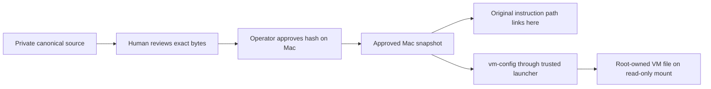

# Private client rules

Keep editable client rules in a selected private source. Activate reviewed bytes through the operator's existing `vm-config` route. A source refresh alone must never replace loaded rules.



## First import

Run from the operator's checkout after its reviewed, trusted signed tip is installed. Provision the selected private source first. Its owner prepares a recipe through the normal private pull request workflow. Keep the recipe, the full original, the diff and the imported file private. Public fixtures use invented text.

The recipe is UTF-8 JSON with exactly `inputSha256` and `replacements`. Each replacement has exactly `before` and `after`, both complete lines including their final newline. `inputSha256` identifies the full authoritative original. Anchors must each occur once in the original and must not overlap. They never match text produced by an earlier replacement. Unmatched bytes pass through unchanged, including unseen sections and whitespace. An incomplete unified diff is not a recipe.

Review the private recipe and record its SHA-256 independently. The import command requires that reviewed hash. A source refresh changing the recipe cannot change what this invocation approves.

```sh
SANDBOX=CLIENT ./bin/client-rules import "$HOME/Development/clients/CLIENT/AGENTS.md" \
  --source SOURCE --file rules/AGENTS.md --recipe rules/import.json \
  --recipe-sha256 REVIEWED_RECIPE_SHA256
```

Use the source catalog name for `SOURCE`. The target directory must already exist in that private checkout, and the target file must not exist. The command confirms repository privacy through the explicit GitHub API repository path and checks that the local clone's origin matches that catalog repository before writing any client text. It accepts only a source selected by this sandbox and a `rules` path directly under `/etc/agent-sandbox`.

The command validates the original hash and every replacement before writing. It creates the canonical file in the private source checkout. It writes an approved snapshot and its hash record beside the Mac's `sandbox.json`, then replaces the original Mac file with a symlink to that snapshot. The canonical file is the only editable home. The snapshot and VM file are installations, pinned to the approval record. Editing the source cannot change the old Mac instruction path.

The command then runs `vm-config`. The existing `rules` value and bootstrap link stay in place. No bootstrap, restart, source signing, key change or remote access change is needed. Publish the newly imported canonical file through its private owner's normal source workflow. The import does not commit, push, open a pull request or authorize publishing its content.

## Later source changes

Edit the canonical file through its private owner workflow. Review the complete private diff and identify the exact resulting file hash. Run this command on the Mac for each activation.

```sh
SANDBOX=CLIENT ./bin/client-rules approve --sha256 REVIEWED_RULES_SHA256
```

A changed source, including a factory-merged change, leaves loaded rules unchanged until this operation. The approval record identifies the previous and desired hash. `vm-config` sends the approved snapshot, not the current source candidate. The VM refuses an existing rules file whose hash matches neither the expected previous bytes nor the approved bytes. Repeating a successful transfer is safe.

This keeps the operator activation step. Removing that step needs an explicit trust decision. Possible designs are operator-signed rule artifacts verified against the existing trusted keys, or a separate human-controlled approval service and identity. An unsigned source watched by the session is insufficient while workers and the factory share the writer account. A merge or an account name does not prove human approval.

## Failures and recovery

| Failure | Result |
| --- | --- |
| Public source, privacy lookup failure, wrong hash, malformed recipe, missing or repeated anchor, symlink escape, existing import destination | Validation refuses before changing the original or destinations. |
| Ordinary local write failure during import | Created destination files are removed and the original remains. |
| Interrupted import | Inspect the private paths before retrying. Existing destinations cause refusal rather than overwrite. |
| VM transfer failure | Local approval remains stored, and the command reports VM installation pending. Retry `SANDBOX=CLIENT ./bin/vm-config` before approving another hash. |
| VM file differs from both expected hashes | The bundle is refused before any configuration write. Investigate the writer through the operator route. |
| Interrupted approval between snapshot and record replacement | The next bundle refuses a hash mismatch. Restore the last reviewed private snapshot and record through the operator route before retrying. |

File replacement is atomic per file. Mac approval and VM installation are separate operations. A successful command is not evidence that an already running agent has reloaded its instructions.

## Verification

Keep private diffs in the private source review. Import proofs must show that only reviewed replacements differ and that branch-resource approvals, registered frontend callback constraints and unrelated rules remain intact. Client policy should link to the global fixture policy rather than repeat it.

On the Mac, hash the canonical source file and the original instruction path with `shasum -a 256`. Both must match the approval record's `sha256`. Measure the VM file with `SANDBOX=CLIENT ./bin/vm-exec sha256sum /etc/agent-sandbox/RULES.md`. From the pot, measure both that file and `/config/AGENTS.md` with `sha256sum`, and confirm the latter still resolves to the configured read-only file. Compare those values with the selected private source checkout's canonical file hash after its owner publishes the import. Report a differing candidate as awaiting approval, not installed.

## Trust boundary

| Trusted side | Untrusted side |
| --- | --- |
| Operator invocation, approved local snapshot, existing operator transport, signed root launcher and root configuration directory | Private source files, recipes and unsigned source updates |

The operator's GitHub authentication is used only by the installed `gh` executable for the privacy lookup. No source script, installer or hook runs during import or approval. The existing source Git adapter reads only local configuration to verify the origin. It disables hooks, filesystem monitors, inherited Git settings and global configuration, and refuses unsupported local keys. Source values travel as parsed JSON and UTF-8 bytes. They never become shell code. Output contains hashes and fixed diagnostics, never rule text. The existing operator transport and signed launcher retain responsibility for root execution and credentials. This feature adds no session endpoint or privilege.

Source files cannot read the operator's environment or process descriptors through this operation because none of their code runs. Regular-file and path checks refuse symlinks. Exclusive creation and private temporary files prevent an existing destination from being followed or overwritten during import. A sandbox-directory lock serializes these commands. An attacker already running as the Mac operator can alter its files and approval record. This path preserves the existing operator boundary and does not claim isolation between processes sharing that account.

`probes/client-rules.py`, run by `bin/check`, exercises preservation, bad anchors, conflicting hashes, public-source refusal, unapproved updates, path escapes and installed-file refusal using synthetic content only. It proves data handling locally. It does not prove Mac-to-VM delivery or a live agent reload.
