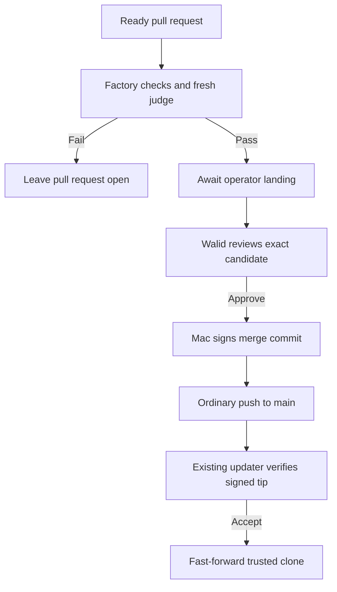

# Factory landing proposal

This proposal recommends that the factory check and judge changes to host-privileged repositories, then wait for Walid to publish an operator-signed merge commit. Approval of this design starts a separate implementation task. This PR changes no runtime, key, GitHub setting or factory policy, and stays draft until Walid decides.



## Why a merge does not land

The [factory merge command](../session/factory-github.mjs) asks GitHub for a squash merge with an exact PR head. GitHub's web-flow signature proves that GitHub made that commit. It does not prove that Walid's operator key approved it. The [Mac updater](../mac/update) and the [VM trusted launcher](../lib/trusted_source.py) require the latter through the [OpenPGP commit verifier](../lib/signed_commit.py). An author name or GitHub's verified badge cannot substitute for that signature.

The task's verified incident evidence is agent-sandbox PRs #22 and #26. Both pots fetched their GitHub-signed main tip but remained at the earlier operator-signed PR #29 merge. A later operator-signed empty commit can approve the accumulated history and let it land, but repeating that recovery leaves the factory reporting merges that have not reached the trusted clones.

Here, landing means advancing the trusted agent-sandbox checkout on a Mac or VM. The [session source provisioner](../README.md#agent-sources) refreshes Pi and Herdr separately. Its fast-forward policy is not the host's signature gate. The proposed factory release policy covers `walid-mos/agent-sandbox`, `walid-mos/agent-pi` and `walid-mos/agent-herdr` because all supply installed code. It does not claim to add cryptographic enforcement to the session source provisioner.

## Fixed guarantees

The [README trust contract](../README.md#boundary-limits) remains the constraint, including its warning that a session token can push everything branch rules permit.

| Guarantee | Required consequence |
| --- | --- |
| A key Walid controls signed the landed tip | Verify the commit's own OpenPGP signature against the installed operator public keys. |
| Main's branch rules and that signature are the gate | Use ordinary permitted pushes, with no bypass actor, force update, reduced check or newly trusted GitHub key. |
| VM root runs a clean, root-owned trusted clone | Keep the launcher, ownership checks, safe Git configuration, tracked-script check and read-only session mount intact. |
| Updates fast-forward the followed branch | Keep main as the release branch, with no independent release ref or rollback reset. |
| One factory bot here runs what main says | Keep orchestration and policy in the versioned factory, installed through the existing signed agent-sandbox update path. |
| Checks do not receive credentials | Keep the existing check container boundary and its attack probe. |
| The factory has no private landing escape | Give the session neither a signing key nor a general signing endpoint. |

An operator signature approves the whole resulting tip, including its ancestry. It is not a statement that every ancestor has an operator signature. Walid must review all changes since the last trusted tip, including any earlier GitHub merges, before signing the next one.

## Options evaluated

| Option | What it requires | Decision |
| --- | --- | --- |
| A. Factory pushes an operator-signed landing commit | Walid first signs a commit with the exact approved tree and parents, then the factory relays that immutable object. | Cryptographically valid, but adds object transport, stale-parent handling and a second publisher without removing the human signing step. Prefer D. |
| A with an unattended signing token | A hardware token or Mac service signs whatever passed the factory's policy. | Reject. An automatic signing request becomes the factory's way to authorize host code. A non-exportable key prevents theft, not signing misuse. |
| B. Operator-signed landing index | The updater verifies a signed mapping from repository and branch to an allowed commit, plus freshness and rollback rules. | Reject under this contract. The GitHub-signed main tip itself remains unsigned by Walid, and both the updater and launcher would need a different acceptance rule. |
| C. Operator countersignature in another ref | Bind approval to the repository, branch and full commit ID, protect publication, then teach every verifier to fetch and validate it. | Reject for the same tip-signature reason. Mutable refs also add deletion, replay and ordering failures. A signed tag is not a signed commit. |
| D. Factory stops before merging these repositories | A passing verdict waits for Walid's local signed merge and permitted fast-forward push. | Recommend. It removes the premature merge and uses the existing landing contract without a new signing service. |
| Periodic signed empty commits after GitHub merges | Walid approves and signs each accumulated main state. | Keep as a deliberate recovery procedure only. Automatic signing of arbitrary main would erase the independent operator decision. |
| Trust GitHub's signing key or a CI signing secret | Expand accepted signers or give automation a private operator key. | Reject. Both give automation authority to satisfy the host gate. |

"Token-signed" in A must mean an OpenPGP signing device controlled by Walid. A GitHub access token authenticates a push or API call and cannot create the required operator signature. A manually approved device signature for one exact commit can satisfy A. Allowing the factory to invoke that device without such approval cannot.

D trades unattended host-code releases for a preserved trust boundary. With only the operator's Mac holding the signing identity, fully unattended landing while that Mac is offline is not achievable under the stated constraints.

## Proposed factory behavior after approval

Use one explicit policy beside the factory's existing repository configuration to identify the repositories requiring operator landing. Leave other repositories' merge behavior alone. The policy is read by the same factory bot and commands, not by another bot, scheduled Mac job or externally fetched configuration. A policy change itself reaches the factory only through an operator-signed agent-sandbox release.

For those repositories, a `PASS` or `PASS+NOTES` posts its head-bound verdict and records `awaiting-operator` instead of calling GitHub's squash merge. The report names the repository, PR, full head, observed base, check results and proposed action. It says that neither merge nor landing has happened. A failure leaves the PR open. Drafts remain ineligible.

A changed head invalidates the approval request and goes through checks and a fresh judge. A changed base requires the PR branch to include that base and the resulting head to pass again. Recording and reporting the waiting state must be idempotent across scans. On restart, the factory reconciles the open PR and its head rather than treating the old PASS as permission to merge. An operator push is observed and reported as merged only after GitHub confirms it. The factory never retries by switching to squash merge.

The waiting record and PR comment are pointers for Walid, not signing authorization. Session code can edit session records and use its GitHub token. Walid independently fetches the public objects, checks GitHub's current PR state, examines the complete change, and approves the exact candidate on the Mac. No request originating in a pot can trigger signing on its own.

## Operator path

The following is a proposed procedure, not commands executed by this PR. Use a separate operator-owned bare Git repository on the Mac, with a fixed HTTPS origin and trusted local tools. Do not use the watchdog's checkout to prepare the merge, since it would install a task branch. Keep the signing key, GPG agent socket and GitHub write credential on the Mac. Do not forward them into a pot or check container.

The stable public reads and preparation primitives are:

```sh
gh pr view PR_NUMBER --repo OWNER/REPOSITORY \
  --json state,isDraft,baseRefName,headRefOid,url

git init --bare OPERATOR_LANDING_STORE
git -C OPERATOR_LANDING_STORE remote add origin https://github.com/OWNER/REPOSITORY.git
git -C OPERATOR_LANDING_STORE fetch --no-tags origin \
  refs/heads/main refs/pull/PR_NUMBER/head
```

Initialize the store once per repository. A future command should parse GitHub's response as data, fetch each ref explicitly, and retain their full object IDs. The multi-ref fetch above shows GitHub's public ref names. It is not a way to identify which `FETCH_HEAD` line is the base.

Before signing, the operator procedure must establish all of these facts:

1. The PR is open, ready, targets main, and still has the head covered by the passing factory verdict.
2. The fetched PR head equals that full head ID. The fetched main tip equals the base used for this attempt.
3. The last trusted release is an ancestor of that base, and that base is an ancestor of the PR head. Otherwise stop. Update a stale PR branch, obtain checks and a new verdict, then restart. An unrelated release history needs a separate operator decision. This avoids inventing an untested conflict resolution on the Mac.
4. The candidate uses exactly the checked head's tree and has the base and head as its two parents. Walid reviews its complete diff from the last trusted release and its history. No extra file change is bundled into signing.
5. Main's existing rules permit the proposed signed fast-forward update and every required check or approval is satisfied on the object the rule requires. If a rule requires checks on the final merge commit, publish that signed object on a review branch for those checks before attempting main. Never use an admin bypass.

With `base`, `head` and `tree` bound to those reviewed full IDs, and `message_file` a local operator-written commit message, the commit primitive is:

```sh
git -C OPERATOR_LANDING_STORE merge-base --is-ancestor "$base" "$head"
git -C OPERATOR_LANDING_STORE rev-parse "$head^{tree}"
git -C OPERATOR_LANDING_STORE diff --no-ext-diff --no-textconv "$last_trusted" "$head"
git -C OPERATOR_LANDING_STORE commit-tree "$tree" \
  -p "$base" -p "$head" -S -F "$message_file"
```

Bind `last_trusted` to the previously trusted release ID, `tree` to the tree lookup's result and `candidate` to `commit-tree`'s result. Stop on any failure. `commit-tree` creates an ordinary signed merge commit without checking out PR files or running their hooks, filters, dependency scripts or installers. Use the Mac's existing Git author, committer and OpenPGP configuration. Do not invent identities, use GitHub's web signing or add a key to the installed signer list. Confirm that the configured signature format is OpenPGP and that the resulting signature verifies with the deployed operator public-key set.

The verification and publication primitives are:

```sh
python3 -I TRUSTED_OPERATOR_CHECKOUT/lib/signed_commit.py verify \
  OPERATOR_LANDING_STORE "$candidate" OPERATOR_SIGNERS_FILE

git -C OPERATOR_LANDING_STORE ls-remote origin refs/heads/main
git -C OPERATOR_LANDING_STORE push origin "$candidate:refs/heads/main"

gh pr view PR_NUMBER --repo OWNER/REPOSITORY \
  --json state,headRefOid,mergeCommit,url
```

Use a previously trusted copy of the verifier and the operator public-key file already used for landing. Re-read the PR and stop if it is closed, draft, retargeted or at another head. Confirm main still equals the captured base before pushing. An observed move cancels the attempt. An ordinary push also rejects a concurrent remote tip outside the candidate's ancestry. Never force, rebase or amend a signed candidate to repair a rejected push. Start a new attempt and review what changed. A concurrently accepted tip already within the candidate's ancestry introduces no unreviewed tree into the signed object.

A direct Git push cannot atomically compare PR head and draft state as GitHub's merge API does. The factory retains that safety by making no merge at all for these repositories. The operator path instead releases only the exact signed object Walid approves, even if PR metadata races the final read. Do not describe it as an atomic PR merge. If atomic PR-state gating is also required of manual operator releases, D is insufficient under these constraints and implementation must wait for another approved design.

This is a fast-forward update of main to a merge commit. The PR head is its second parent, so it becomes part of main's history and GitHub can recognize the PR as merged. There is no subsequent `gh pr merge` call to replace the operator signature. Confirm GitHub's result and the remote tip instead of closing an apparently open PR to simulate success. If confirmation fails, reconcile the remote before retrying.

The existing Mac and VM updates then fetch main, verify its tip, and fast-forward under their existing rules. Landing remains unconfirmed until the trusted clones report their actual HEAD. A later unsigned main tip can prevent a poller from seeing an earlier signed one. This path relies on the existing signature and branch gates, not a promise that a session token cannot disrupt availability.

## Credentials and attack paths

| Trusted principal | Untrusted principal |
| --- | --- |
| Walid on the Mac, holding the operator key and his existing GitHub credential for their configured lifetimes | The pot session, factory records, PR objects, code, dependencies, messages and check output |
| VM root and the installed launcher, holding public verification keys and root-only broker access | The session, which keeps its existing GitHub and vault reach but gains no signing authority |

This proposal introduces no credential or credential-bearing process. The following are implementation acceptance requirements, not probes claimed to have run in this PR.

| Channel | Required closure and attempted attack |
| --- | --- |
| Environment, process inspection and privilege | Signing remains on the Mac with no process or key socket in the session. From a pot, try reading signing environment, descriptors, key files or invoking a signer. None may reach the operator key. |
| Sourced files and tool configuration | Operator preparation reads no PR shell file or tool configuration. Plant profiles, Git hooks, filters and `core.fsmonitor` in PR content and prove none executes during preparation or signing. |
| Tool subprocesses and lookup paths | Only trusted local Git, GPG and the prior verifier run with signing access. Poison PR `PATH`, package commands and configuration and prove no candidate tool runs. |
| Shared files and shell evaluation | Use an operator-owned store and local messages. Parse fixed-format API data and validated full IDs. Attempt symlink substitution and shell metacharacters in PR fields without changing the signed tree or executing a command. |
| Output | Retain only public IDs, verdicts and signature results. A verbose failure must not print key material, credential values or agent connection details. |
| Network | No pot-accessible signing service or forwarded GPG socket exists. Public GitHub reads supply objects, never approval. Attempt a forged passing record and prove it cannot request an automatic signature. |

Retain the existing [check-container attack probe](../session/factory-image/attacks.sh) and [clone-trust probe](../probes/clone-trust.sh). Add implementation proofs for PASS waiting without a merge API call, head/base movement, duplicate scans, restart reconciliation, rule rejection, an invalid signature and successful signed fast-forward landing. Run signing proofs only in disposable repositories with test keys, never the production operator key.

## Failure and removal behavior

| Event | Result |
| --- | --- |
| Walid's Mac is offline, locked or unable to sign | Passing PRs wait unmerged. Existing pots keep their last trusted tip. No automatic release proceeds. |
| Factory disabled | Automated checks, judgments and waiting reports stop. Existing updaters still work. Walid may review, satisfy all existing gates, sign and push manually without factory records. |
| Main rules reject a local signed push | Leave main and the PR unchanged. Report the blocking rule and seek a design decision without weakening it. |
| PR head or observed base moves | Invalidate the attempt and obtain the required new checks, verdict and operator approval. |
| Push fails or its response is lost | Read remote main and PR state first. Reuse only an already published identical object, otherwise restart from current facts. |
| A later unsigned push wins | Trusted clones refuse that tip and keep running their previous signed code. Report release blockage, never accept GitHub's signature as recovery. |
| Checks or waiting records disappear | Reconstruct evidence or rerun checks. Missing evidence grants no signing approval. |
| Signing key unavailable or verification fails | Nothing lands. Key rotation remains a separate operator action through the existing trust installation process. |
| Disable the proposed waiting policy | Do not resume GitHub auto-merges for these repositories without a separately approved landing design. Disabling the factory needs no updater change. |

## Decisions before implementation

Walid must approve D's per-release signing requirement, its explicit operator release authority instead of an atomic GitHub PR merge, and the proposed coverage of the three installed-code repositories. The minimum useful implementation is factory waiting and accurate reporting plus a documented manual operator procedure. A Mac helper can automate preparation later, but must still require approval of the exact candidate and must not become a background signer.

The existing main rules are fixed inputs. Before implementation, validate the signed-push path against their actual requirements and identify any checks required on the final candidate. A read-only inspection during this proposal returned an empty effective-rules response and "Branch not protected" from classic protection for agent-sandbox. That observation grants no permission to change settings or assume the same result for Pi and Herdr. If fixed rules require a GitHub-generated merge object and forbid this signed push, D cannot satisfy both gates. Walid must choose another design, while releases remain blocked. A bypass is not an implementation detail.

Approval must also settle the operator interaction and notification route. Recommend one exact-candidate confirmation on the existing Mac, with waiting reports through the factory's current Principal route. Choose the trusted store location and the supported Mac Git/GPG invocation in implementation, after inspecting the existing operator tooling. The task mentions a Go `commit` recipe on the Mac, but this proposal neither assumes its interface nor makes it a prerequisite.

Bootstrap needs one explicit operator-approved release of the factory change. The old factory cannot be asked to squash-merge its own landing fix and thereby install it. After approval and implementation, Walid must sign and publish that first release through the same existing main gate. This proposal PR remains draft and does not authorize that release.
