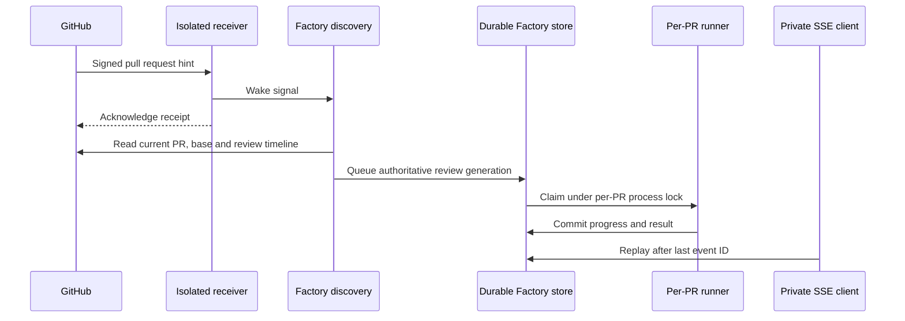

# Factory webhook design

GitHub webhooks wake Factory discovery when a pull request changes. Durable per-PR runners carry checks past the discovery deadline. Reconciliation is a ten-minute backstop. The source and rollout have separate review and activation gates.

## Threat model

The trusted parties are the operator, VM administrators, signed runtime source, the dedicated vault identities and their administrators, GitHub for API state, and Cloudflare for the public transport. Internet clients, webhook fields and headers, worker processes, pull request code, and the code's dependencies are outside the ingress trust boundary. Factory workers and the existing scan share a separate, broader session trust boundary.

| Credential | Intended holder and effect of theft |
| --- | --- |
| `FACTORY_WEBHOOK_SECRET` | GitHub's hook settings and the receiver. Generate 32 random bytes and use their 64 lowercase hexadecimal characters as the literal signing key. Theft permits forged hints within the same budget until rotation. This key grants no GitHub API or Cloudflare access. |
| `FACTORY_TUNNEL_CREDENTIALS` | The connector alone at runtime. A copy can join the dedicated tunnel as a replica, read traffic routed to it, substitute responses or disrupt service. It carries no DNS or account administration permission. |
| GitHub owner credentials | The Factory keeps its existing GitHub permissions and session readers. The ingress services receive none. The scan uses the current wrapper with an allowlisted environment and the owner credentials it needs. Pull request check containers receive no credentials. |
| Cloudflare account certificate and `FACTORY_HOOK_ADMIN_TOKEN` | The certificate stays on the trusted provisioning machine and can manage the account's tunnels. A short-lived token with repository **Webhooks: write** can manage hooks for the selected repositories. Revoke it after the batch. Neither credential goes into the pot. |

### Who can read from the vault

Plain `with-vault` injects the configured GitHub owner tokens and all entries in `sandbox.json`'s `secrets` map into the command environment. `with-vault --with GROUP` **adds** the named `onRequest` group to those defaults. Both inherit the caller's environment. `readSecret(path, name)` fetches a single listed value over the same broker socket. It narrows injection to one value. The broker accepts any process that can reach the mounted socket and checks the request against the pot policy. It has no application identity check. Workers can call it themselves. [Wrapper](../session/vault.mjs) · [Broker](../vm/vault-broker) · [Broker policy](../vm/vault_policy.py)

The broker and session have separate client secrets for the shared Agents Sandboxes identity. Every pot using that identity can read whatever Infisical grants it by logging in directly. Separate client secrets permit independent revocation. They confer the same identity permissions. A process that receives an injected variable may pass it to children, and another process running as the same user may be able to inspect it. [Session boundary](../README.md#boundary-limits)

Keep both ingress keys outside the existing session login's vault permissions and outside all existing broker groups. Before activation, give each ingress launcher a distinct Infisical machine identity scoped to its own secret location. A trusted service supervisor outside the worker container reads exactly the named value at start or approved reload. It passes the signing key over a private descriptor to the receiver and supplies the connector's credential as a `0600` file in its private runtime directory on memory-backed storage. The connector receives only the file path in its signed local configuration. Remove the file on stop and clean up verified leftovers before restart. Scope access to the operator and trusted administrators, vault administrators with access, and the corresponding service. Prove that the deployed machine grants actually enforce that split. A new `onRequest` group, a filtered environment or a different client secret for the shared identity cannot supply that boundary. [Tunnel permissions](https://developers.cloudflare.com/tunnel/features/locally-managed-tunnels/tunnel-permissions/)

### Services and listeners

Run the connector and receiver as separate unprivileged users in a dedicated network namespace on the VM, outside the worker session and its nested Docker daemon. Give each a private filesystem view with read-only signed code, a private runtime directory, and an explicit environment and working directory. Deny privilege escalation, peer process inspection, session and vault-broker mounts, and access to either Docker socket. The trusted supervisor owns the network rules and the only bridge into the session. The receiver emits a fixed signal through a permission-checked local socket to the Factory controller. It receives neither payload nor repository selector. The receiver cannot write the scan's state, launch a scan command or read a scan response.

| Component | Allowed traffic and startup checks |
| --- | --- |
| Cloudflare edge | Scope a WAF Block rule to the dedicated hostname and reject any method other than POST or path other than `/github/factory`. Repeat the exact hostname and anchored path `^/github/factory$` in local ingress, followed by `http_status:404`. Use no private network route, wildcard hostname, SSH route, Tailscale Funnel or inbound VM port. Verify edge rule availability and effective matching before publishing. |
| Connector | Allow outbound HTTP/2 on TCP 7844 to the documented Cloudflare tunnel destinations, DNS to the approved resolver, and HTTP to the receiver's dedicated loopback port. Block other destinations, including metadata, private and tailnet networks, VM and session services and update endpoints. Bind metrics explicitly with `--metrics 127.0.0.1:PORT` on a separate port reachable only by the local supervisor. The container default can bind all interfaces. Publish no metrics, debug or administrative listener. |
| Receiver | Bind the dedicated loopback port before starting the connector. Accept the exact host and raw POST target without a query. Allow response traffic and the fixed local signal only. Deny new IP connections, including calls to the broker or GitHub. The supervisor handles credential reads on a separate path with egress limited to the approved vault endpoint and resolver. |
| Scan and check runner | Keep the scan in the existing Factory session with read/write access to its Factory state and the trusted routines, GitHub client and check runner. It does not share the ingress namespace, mounts or credentials. Use explicit signed tool paths and a clean working directory outside worker checkouts. Keep the check container's restricted mounts, no credential or host Docker socket, and network access only for existing explicitly networked steps. A compromised Factory session retains its existing authority, including its owner tokens and own Docker access. |

Pin a reviewed `cloudflared` version and SHA-256 for each supported architecture in the signed release. Verify the artifact during staging and verify the installed binary before launch. Run the absolute, read-only path with `--no-autoupdate`, the explicit metrics bind, an explicit local configuration path and `--protocol http2`. Exclude the service binary from package and image auto-updates. Updates require a separately reviewed pin and signed rollout. The supervisor checks the running executable, configuration and listener addresses. Verify the configured replica inventory before publishing and withdraw the route if an unexpected replica appears. [Ingress configuration](https://developers.cloudflare.com/tunnel/features/locally-managed-tunnels/configuration-file/) · [Tunnel firewall rules](https://developers.cloudflare.com/tunnel/configuration/#firewall-rules) · [Run parameters](https://developers.cloudflare.com/tunnel/reference/run-parameters/) · [Tunnel metrics](https://developers.cloudflare.com/tunnel/observability/#metrics)

## Hook ownership and payload readers

Use repository webhooks. A user account has no organization feed for its repositories. An App would need registration, installation and Pull requests read permission, and would still need to track the Factory topic. The future provisioning batch starts from Factory discovery, filters against a privately approved list of public repositories, shows additions and removals, and touches only hooks it owns. Keep repository and hook IDs in a private receipt. Adding the topic makes a repository eligible for polling immediately. Removing the topic stops eligibility at the next scan and calls for disabling the old hook by ID during the next authorized reconciliation. Recheck repository visibility before provisioning and before an already hooked public repository is made private. [Hook settings](https://docs.github.com/en/webhooks/using-webhooks/creating-webhooks) · [Repository hooks API](https://docs.github.com/en/rest/repos/webhooks#create-a-repository-webhook)

GitHub sends the full event payload. Private repository names, pull request text, actor and branch details can appear in it. GitHub and authorized delivery-history readers can see it. Cloudflare terminates public TLS at its edge and forwards the request over the encrypted tunnel. The receiving connector, any replica selected by Cloudflare, and the receiver can see the body. Administrators who can inspect those processes or enable payload logging can see it too. HMAC authenticates the body and does not hide it from these readers. Use one intended connector, check replica inventory, exclude the hostname from body logging and caching, and keep headers and bodies out of origin logs. Private repositories stay on polling unless the operator separately approves each repository and the expanded reader set. Disable a public hook before making its repository private. Receiver-side filtering cannot undo disclosure to the edge. [GitHub delivery history](https://docs.github.com/en/webhooks/testing-and-troubleshooting-webhooks/viewing-webhook-deliveries) · [Cloudflare TLS](https://developers.cloudflare.com/ssl/concepts/) · [Tunnel replicas](https://developers.cloudflare.com/tunnel/configuration/#replicas-and-high-availability)

GitHub's hook form offers no way to supply Cloudflare Access service-token headers. Leave this hostname outside Access login and check the signature at the receiver. A hostname-scoped WAF rule using GitHub's `hooks` ranges from `GET /meta` could shed traffic at the edge. Use it only if an owner can maintain the list and verify delivery after changes. Keep HMAC required. [GitHub delivery guidance](https://docs.github.com/en/webhooks/using-webhooks/best-practices-for-using-webhooks) · [Access service tokens](https://developers.cloudflare.com/cloudflare-one/access-controls/service-credentials/service-tokens/) · [Cloudflare custom rules](https://developers.cloudflare.com/waf/custom-rules/)

## Delivery and scheduling

The installed default keeps `factory-watch` on the deployed one-minute scan with a 30-minute routine timeout and the existing review records and commands. The Factory controller and ten-minute reconciliation require `"factoryDurable": true` in the operator’s sandbox configuration. In durable mode the controller opens the private progress socket. It opens a webhook wake socket only when `/etc/agent-sandbox/factory-wake-socket` contains an absolute socket path. The separate receiver requires explicit configuration and the key on descriptor 3.

GitHub deliveries wake a bounded discovery pass. Reconciliation runs every ten minutes as a backstop. It also covers stale drafts using GitHub's creation time and the existing reminder rule. Discovery queues work and exits without waiting for checks. An independent Factory controller starts queued work, watches it, and publishes completed results. Pots 0.8.5 and 0.8.7 run routine commands under an abort signal and expose no SSE route for routine progress in the inspected source. Factory owns its private SSE stream. [Pots 0.8.5 routine timer](https://github.com/Crokily/pi-durable-bot/blob/v0.8.5/src/gateway/timers.ts)

Receipt verifies HMAC-SHA256 over the exact bytes before parsing. It accepts only selected actions on allowlisted public repositories and records only delivery IDs and digests for deduplication. The receiver signals a fixed wake with no payload. Delivery order, actor, head, base and draft flags in the body confer no authority. Bound HTTP headers, body, read time and concurrency at the receiver. The controller retains a pending wake revision when a new delivery arrives during discovery. It waits at least one minute between scan starts and bounds each scan to two and a half minutes. Rejected traffic and retained duplicates schedule no work. A failed wake can be retried. The receiver holds up to 4,096 delivery IDs and digests for 24 hours in memory. After receiver restart, the durable job store still deduplicates checks. The ten-minute routine covers missed deliveries and traffic beyond the receiver limits.

Discovery uses the GitHub API for repository eligibility and current PR state. A bounded retry gives GitHub time to compute mergeability. For a same-head draft-to-ready cycle, the latest GitHub timeline transition distinguishes a new generation. Empty history is a valid baseline only after a successful timeline query. Each generation binds the repository, PR, exact head, base ref, exact base tip and latest authenticated transition. Actions reread those facts before using a review result. An old wake cannot use a replacement record. GitHub's merge call pins the head only. It cannot atomically match the base tip or timeline transition, so independent review of that residual race is a rollout hold.

A base-tip or effective check-input change always creates a new review generation. Discovery records the effective revision of the commands, image ID, helper files and runner sources. The runner checks the revision against its snapshot, and publication and review commands check it again before accepting the result. A repository can reuse a passing result when every trusted step declares `stableInputs: true` and runs without network access. The bundled `bin/check` definitions do not opt in. Their process, socket and deadline tests depend on runtime conditions outside the reuse key. Those steps run against a fresh Git repository with the detached head and its reachable history. They receive the merge-base commit, a fresh working directory, the image by immutable ID, and a read-only snapshot of the check helper files. Stable steps must use only those inputs and their declared commands. They cannot depend on mutable refs, external services, clock, randomness, or checkout metadata such as file timestamps. The cache key also binds the repository, PR, head, base ref, ready transition, platform, host boot identity and check runner source. Each generation runs the container boundary check. A matching result supplies only the check outcome and logs. Publication still reads the current base tip and transition before issuing a new review ID. For signed landing, the checked base must also be an ancestor of the reviewed head and the exact parent of the signed candidate.

The Factory store is private to the trusted controller and runner. Checked code and ingress services cannot write to it. The runner claims under a per-PR OS lock before starting any checks. A replacement controller observes the same lock and reads the persisted events. A runner keeps its lock through cleanup and terminal result. A step has an independent one-hour deadline, including when the Docker client returns success after it expires. Recovery confirms the named and labeled container ID is absent before retrying. An unconfirmed create or failed removal fences that PR as uncertain. Reconciliation reports the fence and keeps other PRs moving. The check container keeps its existing isolation. Only a copy of the exact checked revision and the trusted image files are mounted. The container gets neither a credential nor the Factory store, logs directory, Docker socket or ingress socket. SSE carries trusted stage events only. Check logs remain separate untrusted data.

## Verification and compatibility

Use local synthetic receipts, GitHub facts, clocks and repositories. Verify signature and repository rejection, mergeability retry, reconnect replay, durable terminal results, duplicate input, a lost controller, an uncertain worker and stale head, base and draft transitions. Prove the check container starts and is cleaned up with disposable resources. Deployed vault grants, listener/network isolation, quotas, watchdog and connector pinning require separate staging evidence.

| Draft | Compatibility at the inspected head |
| --- | --- |
| [#30](https://github.com/walid-mos/agent-sandbox/pull/30) | At `f113d57`, the isolated Factory owns publication. Its `factory-verdict.mjs` saves `verdictDelivery` before the comment POST and reads back the saved marker on retry. Carry discovery and runners into that runtime with its signer socket, authority checks and verdict retry intact. Enabling both runtimes would create two publishers. |
| [#53](https://github.com/walid-mos/agent-sandbox/pull/53) | At `8b7184d`, the verifier requires the exact `Factory landing v1` schema, integer generation, base parent and reviewed tree. Keep that schema and recheck the PR transition on the producer side. |
| [#55](https://github.com/walid-mos/agent-sandbox/pull/55) | At `ea7e71c`, review IDs already bind head and generation. These changes touch the same entry points. Resolve the overlap to one binding that also checks base and the current GitHub transition. |

## Activation, rotation and rollback

A later rollout needs fixture results, a signed release and one activation decision for the public canary. The work center owns the independent review hold. The operator owns the signed release and activates only after verifying permissions, quotas and costs. Cloudflare documents the first 1,000 tunnels per account at no charge. Confirm actual plan and quota before provisioning. [Tunnel pricing](https://developers.cloudflare.com/tunnel/features/tunnels-for-platforms/)

| Owner | Future action and permission | Verify and undo | Cost and restart |
| --- | --- | --- | --- |
| Work center and operator | Review the guard and its remaining race. Approve the public repository list, hostname, owners, budgets, signed source and restart window privately. | Compare the signed revision with the review and cancel before provisioning if prerequisites fail. | No new charge. |
| Cloudflare administrator | On the trusted administration machine, use `cloudflared tunnel login` then `cloudflared tunnel create factory-webhook`. Keep `cert.pem` there and defer DNS. | Use `cloudflared tunnel list` and verify the dedicated tunnel and replica inventory. Remove this tunnel after withdrawing its route and stopping the connector on rollback. | Included within documented tunnel capacity if confirmed. No pot restart. |
| Vault administrator and pot operator | Provision separate machine identities and approved grants in the application vault. Use masked input or a reviewed value-safe helper for the named keys. Deploy the signed isolation and scheduler changes in the approved window. Set `factoryDurable` to JSON `true` in the selected pot’s configuration and bootstrap the session. The future implementation must supply the isolated launcher and its install and rollback commands. Existing session configuration commands alone cannot grant launcher-only access. | Verify reader and network boundaries, signed startup, local health, alerts, and the ten-minute `factory-watch` routine. On rollback stop ingress and drain active durable jobs. Remove the opt-in and bootstrap to restore the legacy routine, then revoke the dedicated grants. | Existing VM and vault capacity subject to verification. Bootstrap and service start require the window. |
| Cloudflare administrator | Publish only `factory.example.com` with `cloudflared tunnel route dns TUNNEL_ID factory.example.com`. | Check the proxied DNS record, edge policy and exact path. Confirm outside the tailnet that the route requires a signature and other paths fail. Undo in **DNS → Records**. | Confirm existing zone coverage. No pot restart. |
| GitHub repository administrator | Use **Settings → Webhooks → Add webhook** for the approved public canary. Select JSON, SSL verification, Pull requests and the approved HTTPS path. Use the signing key through the protected provisioning flow. Apply a reviewed batch with **Webhooks: write** for the remaining approved public repositories. | Check GitHub's **Recent Deliveries**, canary scan and fallback, then record created IDs privately. Disable those hooks on rollback and revoke the admin token after provisioning. | No separate webhook fee. No restart. |

For routine webhook-key rotation, disable the owned hooks, publish the new vault value through the protected flow, reload the receiver, update those hooks and re-enable them after verifying a signed canary. The ten-minute reconciliation covers the pause. Test that the old key fails. For suspected signing-key compromise, stop acceptance of the old key immediately and rotate without overlap. For suspected connector compromise, withdraw DNS and stop serving the old tunnel first. Remove the old tunnel and its replicas, replace it with a new dedicated tunnel and credential, verify the new replica and local route, then restore DNS and verify external routing before enabling the hooks. Rotate the HMAC key as well if it was exposed, and review what payloads could have reached the old replica. Rotate launcher machine credentials under their dedicated identities and revoke the old credentials after verified reload, or immediately if compromised. Never print or publish credential values.

## Open before rollout

- The Cloudflare administrator must verify DNS and zone ownership, plan and tunnel headroom, relevant edge features, connector inventory, and the absence of other replicas. An earlier TCP probe established only that a session could reach port 7844. The proposed VM isolation, service routes and actual connector handshake still need proof.
- A previous read-only hook-list request with the session token returned `403`. The repository administrator must verify delegated **Webhooks: write** or carry out the batch. Current permission and repository visibility are rollout inputs. No private repository hook is implied by the Factory topic.
- Verify the vault plan, separate identities and effective reader sets, login and quota limits, API headroom, scan deadline and cleanup, metrics and alert delivery in the target topology. Confirm connector pin support and test the timeline proof and merge race before activation.
