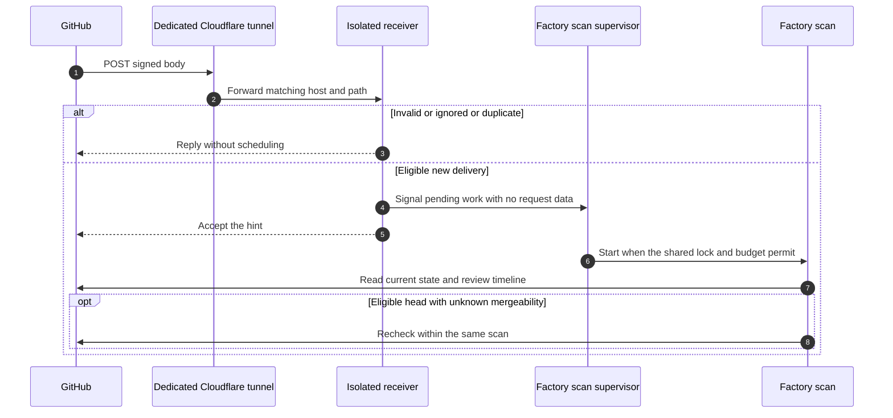
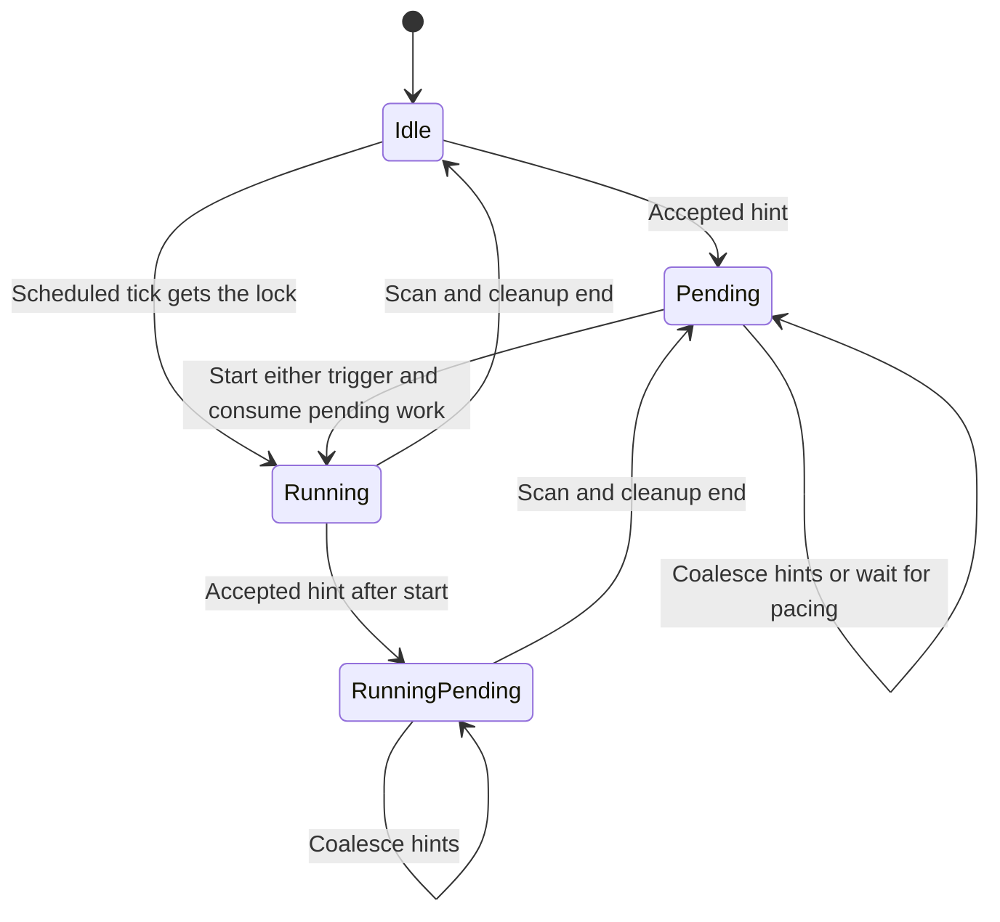

# Factory webhook design

A GitHub delivery would ask the Factory to scan sooner when a pull request becomes ready or returns to draft. The existing one-minute routine would continue to reconcile missed work. This proposal requires separate implementation review and activation.

## Threat model

The trusted parties are the operator, VM administrators, signed runtime source, the dedicated vault identities and their administrators, GitHub for API state, and Cloudflare for the public transport. Internet clients, webhook fields and headers, worker processes, pull request code, and the code's dependencies are outside the ingress trust boundary. Factory workers and the existing scan share a separate, broader session trust boundary.

| Credential | Intended holder and effect of theft |
| --- | --- |
| `FACTORY_WEBHOOK_SECRET` | GitHub's hook settings and the receiver. Generate 32 random bytes and use their 64 lowercase hexadecimal characters as the literal signing key. Theft permits forged hints within the same budget until rotation. This key grants no GitHub API or Cloudflare access. |
| `FACTORY_TUNNEL_CREDENTIALS` | The connector alone at runtime. A copy can join the dedicated tunnel as a replica, read traffic routed to it, substitute responses or disrupt service. It carries no DNS or account administration permission. |
| GitHub owner credentials | The Factory keeps its existing GitHub permissions and session readers. The ingress services receive none. The scan uses the current wrapper with an allowlisted environment and the owner credentials it needs. Pull request check containers receive no credentials. |
| Cloudflare account certificate and `FACTORY_HOOK_ADMIN_TOKEN` | The certificate stays on the trusted provisioning machine and can manage the account's tunnels. A short-lived token with repository **Webhooks: write** can manage hooks for the selected repositories. Revoke it after the batch. Neither credential goes into the pot. |

### Who can read from the vault

Plain `with-vault` injects the configured GitHub owner tokens and all entries in `sandbox.json`'s `secrets` map into the command environment. `with-vault --with GROUP` **adds** the named `onRequest` group to those defaults. Both inherit the caller's environment. `readSecret(path, name)` fetches a single listed value over the same broker socket. It narrows injection to one value. The broker accepts any process that can reach the mounted socket and checks the request against the pot policy. It has no application identity check. Workers can call it themselves. [Wrapper](../session/vault.mjs) · [Broker](../vm/vault-broker) · [Broker policy](../vm/vault_policy.py)

The broker and session have separate client secrets for the shared Agents Sandboxes identity. Every pot using that identity can read whatever Infisical grants it by logging in directly. Separate client secrets permit independent revocation. They confer the same identity permissions. A process that receives an injected variable may pass it to children, and another process running as the same user may be able to inspect it. [Session boundary](../README.md#boundary-limits)

Keep both ingress keys outside the existing session login's vault permissions and outside all existing broker groups. Before activation, give each ingress launcher a distinct Infisical machine identity scoped to its own secret location. A trusted service supervisor outside the worker container reads exactly the named value at start or approved reload. It passes the signing key over a private descriptor to the receiver and supplies the connector's credential as a `0600` file in its private runtime directory on memory-backed storage. The connector receives only the file path in its signed local configuration. Remove the file on stop and clean up verified leftovers before restart. Scope access to the operator and trusted administrators, vault administrators with access, and the corresponding service. Prove that the deployed machine grants actually enforce that split. A new `onRequest` group, a filtered environment or a different client secret for the shared identity cannot supply that boundary. [Tunnel permissions](https://developers.cloudflare.com/tunnel/features/locally-managed-tunnels/tunnel-permissions/)

### Services and listeners

Run the connector and receiver as separate unprivileged users in a dedicated network namespace on the VM, outside the worker session and its nested Docker daemon. Give each a private filesystem view with read-only signed code, a private runtime directory, and an explicit environment and working directory. Deny privilege escalation, peer process inspection, session and vault-broker mounts, and access to either Docker socket. The trusted supervisor owns the network rules and the only bridge into the session. The receiver emits a fixed signal through a permission-checked local socket to a host-owned counter. The scan scheduler reads that counter through a read-only mount. It receives neither payload nor repository selector. The receiver cannot write the scan's state, launch a scan command or read a scan response.

| Component | Allowed traffic and startup checks |
| --- | --- |
| Cloudflare edge | Scope a WAF Block rule to the dedicated hostname and reject any method other than POST or path other than `/github/factory`. Repeat the exact hostname and anchored path `^/github/factory$` in local ingress, followed by `http_status:404`. Use no private network route, wildcard hostname, SSH route, Tailscale Funnel or inbound VM port. Verify edge rule availability and effective matching before publishing. |
| Connector | Allow outbound HTTP/2 on TCP 7844 to the documented Cloudflare tunnel destinations, DNS to the approved resolver, and HTTP to the receiver's dedicated loopback port. Block other destinations, including metadata, private and tailnet networks, VM and session services and update endpoints. Bind metrics explicitly with `--metrics 127.0.0.1:PORT` on a separate port reachable only by the local supervisor. The container default can bind all interfaces. Publish no metrics, debug or administrative listener. |
| Receiver | Bind the dedicated loopback port before starting the connector. Accept the exact host and raw POST target without a query. Allow response traffic and the fixed local signal only. Deny new IP connections, including calls to the broker or GitHub. The supervisor handles credential reads on a separate path with egress limited to the approved vault endpoint and resolver. |
| Scan and check runner | Keep the scan in the existing Factory session with read/write access to its Factory state and the trusted routines, GitHub client and check runner. It does not share the ingress namespace, mounts or credentials. Use explicit signed tool paths and a clean working directory outside worker checkouts. Keep the check container's restricted mounts, no credential or host Docker socket, and network access only for existing explicitly networked steps. A compromised Factory session retains its existing authority, including its owner tokens and own Docker access. |

Pin a reviewed `cloudflared` version and SHA-256 for each supported architecture in the signed release. Verify the artifact during staging and verify the installed binary before launch. Run the absolute, read-only path with `--no-autoupdate`, the explicit metrics bind, an explicit local configuration path and `--protocol http2`. Exclude the service binary from package and image auto-updates. Updates require a separately reviewed pin and signed rollout. The supervisor checks the running executable, configuration and listener addresses. Verify the configured replica inventory before publishing and withdraw the route if an unexpected replica appears. [Ingress configuration](https://developers.cloudflare.com/tunnel/features/locally-managed-tunnels/configuration-file/) · [Tunnel firewall rules](https://developers.cloudflare.com/tunnel/configuration/#firewall-rules) · [Run parameters](https://developers.cloudflare.com/tunnel/reference/run-parameters/) · [Tunnel metrics](https://developers.cloudflare.com/tunnel/observability/#metrics)

## Hook ownership and payload readers

Use repository webhooks. A user account has no organization feed for its repositories. An App would need registration, installation and Pull requests read permission, and would still need to track the Factory topic. The future provisioning batch starts from Factory discovery, filters against a privately approved list of public repositories, shows additions and removals, and touches only hooks it owns. Keep repository and hook IDs in a private receipt. Adding the topic makes a repository eligible for polling immediately. Removing the topic stops eligibility at the next scan and calls for disabling the old hook by ID during the next authorized reconciliation. Recheck repository visibility before provisioning and before an already hooked public repository is made private. [Hook settings](https://docs.github.com/en/webhooks/using-webhooks/creating-webhooks) · [Repository hooks API](https://docs.github.com/en/rest/repos/webhooks#create-a-repository-webhook)

GitHub sends the full event payload. Private repository names, pull request text, actor and branch details can appear in it. GitHub and authorized delivery-history readers can see it. Cloudflare terminates public TLS at its edge and forwards the request over the encrypted tunnel. The receiving connector, any replica selected by Cloudflare, and the receiver can see the body. Administrators who can inspect those processes or enable payload logging can see it too. HMAC authenticates the body and does not hide it from these readers. Use one intended connector, check replica inventory, exclude the hostname from body logging and caching, and keep headers and bodies out of origin logs. Private repositories stay on polling unless the operator separately approves each repository and the expanded reader set. Disable a public hook before making its repository private. Receiver-side filtering cannot undo disclosure to the edge. [GitHub delivery history](https://docs.github.com/en/webhooks/testing-and-troubleshooting-webhooks/viewing-webhook-deliveries) · [Cloudflare TLS](https://developers.cloudflare.com/ssl/concepts/) · [Tunnel replicas](https://developers.cloudflare.com/tunnel/configuration/#replicas-and-high-availability)

GitHub's hook form offers no way to supply Cloudflare Access service-token headers. Leave this hostname outside Access login and check the signature at the receiver. A hostname-scoped WAF rule using GitHub's `hooks` ranges from `GET /meta` could shed traffic at the edge. Use it only if an owner can maintain the list and verify delivery after changes. Keep HMAC required. [GitHub delivery guidance](https://docs.github.com/en/webhooks/using-webhooks/best-practices-for-using-webhooks) · [Access service tokens](https://developers.cloudflare.com/cloudflare-one/access-controls/service-credentials/service-tokens/) · [Cloudflare custom rules](https://developers.cloudflare.com/waf/custom-rules/)

## Delivery and scheduling

Verify HMAC-SHA256 over the raw bytes with a constant-time comparison before parsing JSON. Accept `pull_request` actions `opened`, `reopened`, `ready_for_review`, `synchronize` and `converted_to_draft` with the expected payload shape. A draft conversion can wake discovery while the pull is still a draft. The draft flag is not a prerequisite for scheduling any of these actions. A signed `ping` and irrelevant events return `204`. A new hint returns `202` after the local signal accepts it. A failed signal returns `503` and leaves its deduplication entry unset. The signature covers the body only. Event headers and body fields filter hints. The scan discovers repositories, pull requests and heads itself. [GitHub events and headers](https://docs.github.com/en/webhooks/webhook-events-and-payloads) · [Failed deliveries](https://docs.github.com/en/webhooks/using-webhooks/handling-failed-webhook-deliveries)

### Mergeability still computing

The existing scan skips `UNKNOWN`. In the proposed scan, use the authenticated listing to select at most ten otherwise eligible heads whose mergeability is unknown. Recheck them in one batched GraphQL read after five seconds and once more at fifteen seconds from initial discovery. Give each read at most five seconds and skip it if the shared deadline or API budget cannot accommodate it. Each retry rechecks current open and draft state and the expected head. Drop a closed, drafted or moved head and let the next discovery reconcile it. A known result goes through the existing checks during this scan. Report heads still unknown, over the batch limit or blocked by budget as deferred for the next scheduled scan. The retry adds at most two API calls and twenty seconds, runs inside the lock and spends no extra scan start or vault login. Apply it to both triggers. [Current scan](../session/factory-scan.mjs) · [GitHub mergeability states](https://docs.github.com/en/graphql/reference/pulls)

### Same-head draft and ready transitions

The current scan holds a record when it sees the pull in draft. A draft-to-ready cycle between scans can leave the prior record intact. `converted_to_draft` gives the scan an earlier chance to see the draft. If that window has closed, query GitHub GraphQL `PullRequest.timelineItems` filtered to `CONVERT_TO_DRAFT_EVENT` and `READY_FOR_REVIEW_EVENT` for the pull discovered by the scan. Use the event type and node ID of the latest transition from GitHub, alongside the current head and draft state. Use a verified empty timeline as the baseline for pulls opened ready. Delivery order, timestamps, bodies and duplicate hints carry no authority. [GitHub pull request timeline schema](https://docs.github.com/en/graphql/reference/pulls)

Bind each review record to the GitHub transition and a local review generation. A confirmed draft holds the record. A confirmed newer ready transition on the same head retires the old review and starts one fresh generation even if no scan saw the draft. Keep wake IDs keyed by stage, head and generation. On adoption, recheck a preexisting review without a verified baseline before letting it act. If history is unavailable, incomplete within the query budget or inconsistent with current state, defer the affected pull and report it. Keep unrelated pulls moving. Carry the generation in Factory wake commands. Each action checks that the command still names the active generation and verifies the GitHub state and transition before using the record. Recheck before merge as well. Reject work from a superseded generation. GitHub's current merge call can match the head. It cannot atomically match a timeline event, so a same-head cycle between that final API check and the merge remains a race. Independent review must accept that residual window before enabling automatic merges under this design. [Current action guard](../session/factory-github.mjs) · [Current wake IDs](../session/factory-reports.mjs)

### Shared deadline and alerts

Send scheduled ticks and webhook hints through one scan supervisor. It holds an exclusive process lock before credential acquisition or Factory state changes. When a scan starts, consume only hints already seen by the supervisor. A newer counter value sets one pending follow-up. A refused start leaves pending work queued. A scheduled tick can satisfy the pending hint. A tick that finds the lock busy skips with no backlog. A restart can lose hint or deduplication state. The routine uses the same one-minute default in both modes and runs independently of the ingress services. [Current routine](../session/factory-bot.mjs)

Give both trigger types one monotonic 30-minute deadline for credential acquisition, reads, checks and cleanup. Reserve the final 30 seconds for termination and reaping of the managed process tree and teardown of its owned check containers. The supervisor holds the lock until that teardown is confirmed even if the routine caller times out or the scan process crashes. A successor must reconcile recorded ownership before admitting a scan. On uncertain cleanup, block new scans and alert the work center instead of allowing overlap. The scheduler's outer timeout must allow the supervisor to finish reporting its outcome.

Monitor the connector process and connected-edge metric, receiver readiness and the scan supervisor independently of the processes they monitor. At one-minute intervals the watchdog checks the last scheduled tick, last successful scan, active scan age and terminal outcome. Notify the work center immediately on deadline or unconfirmed cleanup, and after two consecutive missed health checks for a stopped or disconnected connector, an unresponsive receiver or scheduler, or absent scan progress when idle. Distinguish an active scan within its deadline from a failed or stale one. Deliver alerts through the existing private reporting path with a supervisor log or alert visible to the operator when the gateway is down. Deduplicate per incident, report recovery, and omit payloads and values. Keep scheduled scanning through ingress failures. [Tunnel health and metrics](https://developers.cloudflare.com/tunnel/observability/)

### Request, scan and vault budgets

Admit at most eight simultaneous receiver connections with one request per connection. Limit the complete header and body read to two seconds, headers to 8 KiB and the body to 1 MiB, including streamed and chunked input. Reject unsupported content encodings. Limit CPU and memory in the service and measure the total acknowledgment time under that cap against GitHub's ten-second deadline. GitHub's delivery limit is 25 MB, so the one-minute routine must cover a legitimate oversized delivery. These are receiver limits. They cap neither edge traffic nor Cloudflare resource usage. [GitHub delivery guidance](https://docs.github.com/en/webhooks/using-webhooks/best-practices-for-using-webhooks) · [GitHub payload cap](https://docs.github.com/en/webhooks/webhook-events-and-payloads#payload-cap)

| Request class | Effect on scans |
| --- | --- |
| Wrong route, method, signature, encoding or shape, oversized or slow request, excess connection, or valid irrelevant event | Zero scans. |
| Redelivery or repeated signed body | Zero additional scans while retained. Store at most 4,096 accepted IDs and digests for 24 hours. Match either ID or verified body digest. When the cache is full, return `503` for new hints until entries expire and count those refusals. This design can fill the cache at about 2.8 distinct accepted deliveries per minute sustained over 24 hours. Verify capacity before activation. |
| Eligible request outside the cache, including replay after expiry or restart | At most one scan request per eligible delivery, with one pending slot shared by the entire burst. An idle supervisor may start right away. During a scan, a continuous signed stream can fill that one slot after each start. |

Pace webhook starts at least 60 seconds apart across restarts, using a monotonic timestamp under the shared lock. When prior state cannot be recovered, hold webhook starts for 60 seconds. A scheduled scan remains eligible each minute. Never replay missed ticks. In a half-open hour the program can admit at most 60 scheduled and 60 webhook starts before coalescing and provider backoff. The mergeability retries count against API usage within those starts. Keep the one-minute polling default until measurements of discovery delay, missed deliveries, scan runtimes, and API and vault usage support a separately reviewed change.

A scan rate is not an API rate. Count the GitHub calls, pages and GraphQL points per scan and identity, including discovery, timeline reads, mergeability retries, and other users of the same token's quota. GitHub documents typical authenticated user limits of 5,000 REST requests and 5,000 GraphQL points per hour with separate secondary limits. The same user can share a quota across tokens. Establish a per-identity request, page and point ceiling from measured baseline use and available quota before enabling webhook starts. Reserve capacity for scheduled scans and actions. Decline extra starts when capacity is unknown or low, and honor provider backoff and reset headers without spinning or extending the scan deadline. Validate with a fake API returning quota exhaustion and secondary throttles. [GitHub REST limits](https://docs.github.com/en/rest/using-the-rest-api/rate-limits-for-the-rest-api) · [GitHub GraphQL limits](https://docs.github.com/en/graphql/overview/rate-limits-and-query-limits-for-the-graphql-api)

The current broker performs one Universal Auth login per credential request, followed by a secret read per requested name. The GitHub wrapper reads tokens from the injected environment. With one broker request per scan, the start ceiling allows 120 logins and `120 × N` secret reads per hour, where `N` is the number of names requested. At most half of that ceiling comes from webhook starts. Include other broker callers, pots sharing an egress IP and launch retries in the estimate. Ingress secrets are loaded only on start or rotation. An HTTP request, duplicate or in-scan retry never triggers a login. Infisical Cloud documents an aggregate cap of 600 requests per minute per client IP and plan-dependent category limits, including 120 secret requests per minute on Free. Universal Auth can impose client-secret use and expiry limits, access-token use limits, and failed-login lockout. This repository mints the shared client secrets with unlimited TTL and uses. The provider references give no separate numeric login limit for this deployment. Verify any endpoint-specific caps, lockout and access-token settings, plan and shared usage before rollout. Use a bounded, backed-off startup retry on transient failures. A sustained refusal or throttling alerts the operator and suppresses extra starts. [Infisical rate limits](https://infisical.com/docs/api-reference/overview/rate-limits) · [Universal Auth](https://infisical.com/docs/documentation/platform/identities/universal-auth) · [Session credential minting](../mac/mint-session-credentials.ts)

## Guarantees and verification plan

These are proposed implementation checks. Use a credential-free disposable VM or namespace with synthetic values, a loopback fake sender, fake GitHub and vault endpoints, an injectable clock, fake children and an isolated check runner. Take real listener, file, process and route observations inside that fixture. Deny external network access. Keep production configuration, broker and Docker sockets, credentials and state out of the fixture.

| Guarantee | Future proof |
| --- | --- |
| Off unless enabled and polling stays | Boot without the opt-in and prove there are no new listeners, processes or vault reads. Assert the original routine registration. Enable the fixture, refuse invalid configuration, stop ingress and lose a queued hint in separate cases. Assert one-minute reconciliation without the connector. |
| Payload only requests discovery | Test known signatures, wrong or missing signatures, bad key length or encoding, malformed JSON, wrong shape, ignored events, signed ping and local signal failure. Change the fake GitHub head or topic after delivery. Assert that only the authenticated read drives records, wakes and actions. |
| Mergeability retry is bounded | Return `UNKNOWN` on the first ready scan and then `MERGEABLE`. Prove checks start in that scan before the next scheduled tick. Keep results unknown in a separate case and assert the two-call and time ceilings, no extra vault login or scan start, and later scheduled recovery. Cover a moved head, draft, throttle and deadline. |
| A same-head review can be superseded | Convert to draft and back between scans in the fake GitHub timeline, with the same head and a previous checked record. Deliver the hints out of order, then repeat with both absent. Verify one new generation and wake and rejection of the old verdict. Separately keep the GitHub timeline unchanged with only a signed draft hint, observe a real draft, and make history unavailable. Verify no invented transition, a confirmed hold, and refusal to act without proof, respectively. |
| Work stays bounded and failures are visible | Test method, host and path failures, slow headers, excess connections, oversized fixed and chunked bodies, cache expiry and saturation, and repeated bodies with new IDs. Hold a fake scan while a signed burst and scheduled tick arrive. Assert one pending follow-up and 60-second webhook pacing through a restart. Hang a child and its check container under each trigger. Assert timeout, alert and no lock release before teardown. Stop the connector or gateway and verify the independent watchdog, private alert or supervisor log, and recovery. |
| One public route and a pinned connector | Check local ingress with `cloudflared tunnel ingress validate` and `cloudflared tunnel ingress rule` offline. Exercise alternate hosts, normalized and encoded paths, port collision, and attempts to connect to metrics, VM services, other session listeners, metadata and the Internet from each service identity. Assert only the intended connections succeed. Verify the binary digest, reject a changed executable, inspect the explicit metrics bind and prove auto-updates and other replicas are excluded by the deployment contract. |
| Credentials stay in their intended boundary | Try reads from each service, an unrelated worker, a fake peer pot with the shared identity and a check container. Assert the dedicated vault ACLs and runtime file, socket and process isolation deny unintended readers. Try environment inheritance, planted config or symlinks, and untrusted executable lookup. Assert fixture values never enter argv, scan or check environments, logs or public files. Verify rotation, expiry and cleanup after failure. |
| Private hooks are a separate decision | Provision from fake inventory containing public, private and recently reclassified repositories. Assert the default plan creates hooks for approved public repositories only. Verify private repositories are covered by polling and rollout refuses unknown visibility. |

## Activation, rotation and rollback

A later rollout needs a separately authorized implementation, fixture results, a signed release and one activation decision for the public canary. The work center owns the independent review hold. The operator owns the signed release and activates only after verifying permissions, quotas and costs. Cloudflare documents the first 1,000 tunnels per account at no charge. Confirm actual plan and quota before provisioning. [Tunnel pricing](https://developers.cloudflare.com/tunnel/features/tunnels-for-platforms/)

| Owner | Future action and permission | Verify and undo | Cost and restart |
| --- | --- | --- | --- |
| Work center and operator | Review the guard and its remaining race. Approve the public repository list, hostname, owners, budgets, signed source and restart window privately. | Compare the signed revision with the review and cancel before provisioning if prerequisites fail. | No new charge. |
| Cloudflare administrator | On the trusted administration machine, use `cloudflared tunnel login` then `cloudflared tunnel create factory-webhook`. Keep `cert.pem` there and defer DNS. | Use `cloudflared tunnel list` and verify the dedicated tunnel and replica inventory. Remove this tunnel after withdrawing its route and stopping the connector on rollback. | Included within documented tunnel capacity if confirmed. No pot restart. |
| Vault administrator and pot operator | Provision separate machine identities and approved grants in the application vault. Use masked input or a reviewed value-safe helper for the named keys. Deploy the signed isolation and scheduler changes and bootstrap the selected pot in the approved window. The future implementation must supply the isolated launcher and its install and rollback commands. Existing session configuration commands alone cannot grant launcher-only access. | Verify reader and network boundaries, signed startup, local health, alerts, and the one-minute `factory-watch` routine. On rollback remove the opt-in, stop the ingress services, restore the prior routine and revoke the dedicated grants. | Existing VM and vault capacity subject to verification. Bootstrap and service start require the window. |
| Cloudflare administrator | Publish only `factory.example.com` with `cloudflared tunnel route dns TUNNEL_ID factory.example.com`. | Check the proxied DNS record, edge policy and exact path. Confirm outside the tailnet that the route requires a signature and other paths fail. Undo in **DNS → Records**. | Confirm existing zone coverage. No pot restart. |
| GitHub repository administrator | Use **Settings → Webhooks → Add webhook** for the approved public canary. Select JSON, SSL verification, Pull requests and the approved HTTPS path. Use the signing key through the protected provisioning flow. Apply a reviewed batch with **Webhooks: write** for the remaining approved public repositories. | Check GitHub's **Recent Deliveries**, canary scan and fallback, then record created IDs privately. Disable those hooks on rollback and revoke the admin token after provisioning. | No separate webhook fee. No restart. |

For routine webhook-key rotation, disable the owned hooks, publish the new vault value through the protected flow, reload the receiver, update those hooks and re-enable them after verifying a signed canary. The one-minute scan covers the pause. Test that the old key fails. For suspected signing-key compromise, stop acceptance of the old key immediately and rotate without overlap. For suspected connector compromise, withdraw DNS and stop serving the old tunnel first. Remove the old tunnel and its replicas, replace it with a new dedicated tunnel and credential, verify the new replica and local route, then restore DNS and verify external routing before enabling the hooks. Rotate the HMAC key as well if it was exposed, and review what payloads could have reached the old replica. Rotate launcher machine credentials under their dedicated identities and revoke the old credentials after verified reload, or immediately if compromised. Never print or publish credential values.

## Open before rollout

- The Cloudflare administrator must verify DNS and zone ownership, plan and tunnel headroom, relevant edge features, connector inventory, and the absence of other replicas. An earlier TCP probe established only that a session could reach port 7844. The proposed VM isolation, service routes and actual connector handshake still need proof.
- A previous read-only hook-list request with the session token returned `403`. The repository administrator must verify delegated **Webhooks: write** or carry out the batch. Current permission and repository visibility are rollout inputs. No private repository hook is implied by the Factory topic.
- Verify the vault plan, separate identities and effective reader sets, login and quota limits, API headroom, scan deadline and cleanup, metrics and alert delivery in the target topology. Confirm connector pin support and test the timeline proof and merge race before activation.
