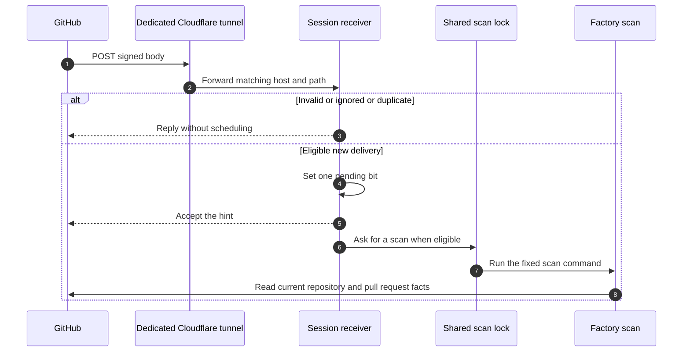
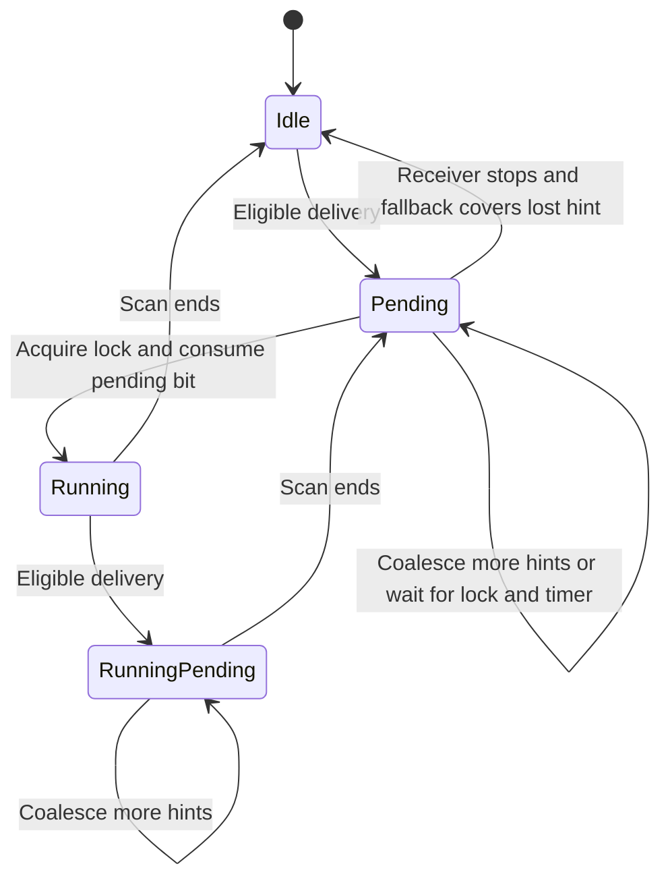

# Factory webhook design

GitHub deliveries would ask the Factory to scan sooner when a pull request becomes ready. The periodic scan would recover missed work. This is a design for separate review, implementation and activation.

## Threat model

| Trusted for this design | Untrusted input |
| --- | --- |
| Operator, signed runtime source, the pot's private configuration and vault broker, Cloudflare's routing for the dedicated tunnel, and GitHub state read by the scan | Internet clients, all request fields, delivery headers, replayed requests, pull request text, and pull request code and dependencies |

| Credential | Holder, lifetime and effect of theft |
| --- | --- |
| `FACTORY_WEBHOOK_SECRET` | GitHub's hook settings and receiver memory for one activation. The receiver expects 32 random bytes represented as 64 lowercase hex characters and signs with the literal text GitHub receives. Theft permits forged hints under the same scan budget until rotation. The key grants neither API nor tunnel access. |
| `FACTORY_TUNNEL_CREDENTIALS` | The connector receives the named vault value at launch. Use a private runtime credentials file with mode `0600`, outside the checkout, removed at stop. The argument contains its path only. Theft permits joining this dedicated tunnel, intercepting deliveries sent to the rogue replica, or substituting responses and routes there. The credential has no Cloudflare DNS or account administration right. Remove the DNS route and replace the tunnel after a leak. |
| Existing GitHub owner credentials | The scan and Factory commands retrieve their existing credentials as they do today. The receiver and connector start without these values, and scan subprocesses inherit neither webhook credential. |
| Cloudflare account certificate and GitHub hook administrator | The operator's Cloudflare login and resulting `cert.pem` stay on the trusted administration machine. The certificate can manage tunnels across the account. A short-lived `FACTORY_HOOK_ADMIN_TOKEN` may create, inspect or disable hooks on selected repositories with **Webhooks: write**. The token stays outside the pot and is revoked after the batch. |

Run the receiver and connector inside the existing session so they can share loopback. A connector in the VM would need a new path across the session boundary. The pot's worker account can use Docker and the existing broker. A compromised worker can inspect same-user processes and runtime files, change user-owned state, interfere with the services, and reach the existing Factory commands. Theft of the connector credential plus control of the session can undo the routing restriction. Treat that as a pot compromise and withdraw the public route before recovery. Keep the existing check-container isolation for pull request code. [Session boundary](../README.md#boundary-limits) · [Tunnel permissions](https://developers.cloudflare.com/tunnel/features/locally-managed-tunnels/local-tunnel-terms/#permissions)

| Channel | Proposed control |
| --- | --- |
| Network | Generate one ingress rule for the exact hostname and anchored path `^/github/factory$` and end with `http_status:404`. Route to a dedicated `127.0.0.1` port. The receiver independently checks host, exact raw target without query, and HTTP method. Bind before starting the connector and refuse startup if the port is occupied. Keep metrics on a separate loopback socket. |
| Process, lookup and files | Use explicit paths from the signed installation for the launcher, connector and scan. Start with an allowlisted environment and a working directory outside any worker checkout. The site configuration is parsed as data and only the validated hostname and loopback port can affect ingress. Use a private state directory for the scan lock and reject symlinks. The runtime config carries names and routing settings only. |
| Request computation and subprocesses | Authenticate the raw body with HMAC-SHA256, a keyed signature, and a constant-time comparison before parsing JSON. A hint has zero arguments. Request fields never become commands, filenames, log strings, URLs or inputs to a Factory record. Reject invalid settings before opening the socket. |
| Output | Count response classes, pending state, scan starts, lock waits and time since last successful fallback. Rate-limit summaries and omit headers, payloads, credentials and stack dumps. Keep connector logging out of debug mode. |

GitHub repository hooks support HTTPS, JSON, a secret and event selection. Cloudflare Access service authentication requires headers the hook cannot set. Leave this hostname outside Access login and authenticate in the receiver. Consider GitHub's `hooks` IP ranges from `GET /meta` as a separate edge filter. Start without that filter because stale ranges can cause missed deliveries. Add a hostname-scoped WAF Block rule only when an owner can refresh the ranges and verify deliveries. An IP allowlist never replaces the signature check. [GitHub hook settings](https://docs.github.com/en/webhooks/using-webhooks/creating-webhooks) · [GitHub delivery guidance](https://docs.github.com/en/webhooks/using-webhooks/best-practices-for-using-webhooks) · [Access service tokens](https://developers.cloudflare.com/cloudflare-one/access-controls/service-credentials/service-tokens/) · [Cloudflare custom rules](https://developers.cloudflare.com/waf/custom-rules/)

## Hook ownership

Use repository webhooks. A user-owned account has no organization feed for these repositories. A repository hook can target each repository currently selected by the Factory's `factory` topic query. A GitHub App needs registration, installation on the selected repositories, and Pull requests read permission for the same events. It still needs a rule for how installations and selected repositories follow topic changes. The repository hooks need one batch of administrative work, with no long-lived hook administrator in the pot. [Pull request event availability](https://docs.github.com/en/webhooks/webhook-events-and-payloads#pull_request) · [Repository webhooks API](https://docs.github.com/en/rest/repos/webhooks#create-a-repository-webhook)

The future provisioning batch uses the Factory's discovery result, first shows the exact additions and removals, then writes only hooks owned by this deployment. Keep the repository IDs and new hook IDs in a private receipt. A new topic is picked up by the periodic scan before a hook is added. A removed topic stops making its pulls eligible at the next scan even if the old hook remains. The next authorized reconciliation disables that hook by ID. Leave unrelated hooks alone.

## Delivery and scheduling

Accept `pull_request` actions `opened`, `reopened`, `ready_for_review` and `synchronize` when the body has the expected pull request shape and says the pull is ready. A signed `ping` and irrelevant events return `204`. These selectors decide only whether to ask for a scan. GitHub HMAC covers the body, not event or delivery headers. Match the event header against the expected body shape and never use the header for authority. The scan reads the topic, readiness, head and mergeability from GitHub. The verdict path keeps its current checks and head recheck, and wakes keep their existing IDs. GitHub advises accepting a delivery within 10 seconds and gives manual redeliveries the original delivery ID. [Webhook events and headers](https://docs.github.com/en/webhooks/webhook-events-and-payloads) · [Failed deliveries](https://docs.github.com/en/webhooks/using-webhooks/handling-failed-webhook-deliveries)

The periodic and webhook paths both take an exclusive process-held lock at the scan entry point before touching Factory state. The lock stays held until the scan and its child processes finish or are stopped. A periodic tick that finds it held exits without starting another scan. For a webhook attempt, move the pending bit into an in-flight slot when asking for the lock. A new hint sets the pending bit again, including while the start is being confirmed. If the gate refuses the start, restore the in-flight hint by setting the bit. Once the scan starts, discard the in-flight hint. On exit, retry the pending hint when the next start is allowed. Use a bounded wait between failed lock acquisitions. Give webhook scans the same termination limit and cleanup as periodic scans. A crash can lose an in-memory hint, so the routine must be independent of receiver and connector health.

### Request bounds

The proposed receiver admits up to eight simultaneous connections and closes each after one request. Each request gets at most two seconds total for headers and body, an 8 KiB header budget and a 1 MiB body budget enforced while reading, including chunked bodies. Reply as soon as validation and scheduling finish. GitHub's own 25 MB delivery cap is higher, so an oversized real event is recovered by the periodic scan. The bounds below apply at the receiver, after Cloudflare. They do not cap network traffic at the public hostname.

| Request class | Effect on scans |
| --- | --- |
| Wrong route, method, signature, encoding or malformed body. Oversized, slow or over-capacity traffic. | Zero scans. Reject before scheduling. A valid but irrelevant delivery also schedules zero. |
| Redelivery or repeat of an already accepted signed body | Zero additional scans while retained. Keep a 24-hour in-memory cache with at most 4,096 entries. Treat a match on either delivery ID or verified raw-body digest as a repeat, so relabeling the unsigned ID alone cannot bypass it. Add entries only when accepting a hint and reject a new hint with `503` when the cache is full of unexpired entries. |
| One eligible request outside the cache, including a replay after expiry or restart | At most one new pending scan. A request may have no effect if the bit is already set. A stolen webhook key can produce fresh valid bodies, so use the same bound for every accepted hint. |
| Burst of distinct valid deliveries during a running scan | At most one queued follow-up, regardless of burst size. A sustained stream can request another follow-up after each new scan starts. |

Allow one webhook scan start per 60 seconds. Count the budget from the last successful webhook start and give a freshly started receiver an initial 60-second hold if it cannot prove when a prior instance started a scan. Keep the last start for the current boot in private supervisor state and enforce the budget under the scan lock. Any interval of length `T` seconds contains at most `floor(T / 60) + 1` webhook starts. Each enabled fallback tick can add at most one start, at ten-minute intervals, subject to the same exclusive lock. A ten-minute tick is a chance to reconcile, not a maximum wait when scans, the gateway or GitHub are unavailable.

## Guarantees and verification plan

`main` already reads watched repositories and pull facts in the scan, guards Factory actions with a GitHub recheck, and assigns wake IDs in the reporting code. The current interval and timeout belong to the bot registration. The controls below are requirements for a later implementation. Run these checks with a loopback fake sender, fake time for scheduling, a fake scan and temporary private state. The fixture must have no production credentials, outbound GitHub calls, live daemon or live record directory. [Scan](../session/factory-scan.mjs) · [Action guard](../session/factory-github.mjs) · [Wake IDs](../session/factory-reports.mjs) · [Routine](../session/factory-bot.mjs)

| Guarantee | Proposed enforcement and future proof |
| --- | --- |
| Off unless enabled | No `factoryWebhook` section means no listener, connector, new service process, credential read or interval change. A disabled bootstrap fixture must observe the original routine registration only. An invalid enabled config must fail closed and leave periodic scanning enabled. |
| A delivery only speeds up discovery | Test known raw-body signatures, wrong and missing signatures, wrong secret length and encoding, malformed JSON, wrong event shape, ignored events and a signed `ping`. Accept one ready event, then change the fake GitHub head or remove its topic before the scan and prove the decision uses GitHub's result. Verify checks, verdict rules and wake IDs still pass their existing cases. |
| Bounded HTTP and scans | Test wrong method, path and host, slow headers, excess connections and both declared and chunked oversized bodies. Assert scan counts for duplicate IDs and changed IDs with identical bodies, cache expiry and capacity, and different signed bodies in a burst. Hold a fake scan open, send a burst and a periodic tick, then release it. Assert one follow-up, no overlap, and the start budget through restart and timeout. Assert child cleanup finishes before the lock is released. |
| One public route | Check the generated config with `cloudflared tunnel ingress validate` and `cloudflared tunnel ingress rule`. In a disposable setup, verify the exact host/path maps to the receiver and other hosts and paths map to 404. Include encoded paths and path normalization cases and confirm the app rejects variants the connector forwards. Check the receiver socket is loopback-only and the connector refuses to start when the dedicated port is occupied. |
| Secrets stay named | Use generated fixture values and prove that arguments, logs, scan child environment and check containers carry neither value. Check connector file ownership and mode, cleanup after normal stop or startup failure, and refusal to follow a planted symlink. Document same-user visibility as a pot-level risk. |
| Fallback stays | Drive the configured routine through receiver crash, tunnel failure, rejected requests and lost in-memory hints. Show the scan still finds missed ready pulls. Assert the enabled interval is ten minutes and the disabled interval comes from the existing registration constant. |
| Public repository contains no private settings | Inspect the diff for private hostnames, accounts, team names, IDs, receipts and secrets. Use `factory.example.com` in examples and toy keys in isolated test fixtures. |

## Activation checklist

A later rollout needs independent trust-boundary review, a separately authorized implementation and one activation decision. Require a verified signed release and a restart window for the selected pot. The steps below are for that rollout. Future commands that the implementation must supply are marked as such. Neither the route nor the hooks need a public port on the VM. Cloudflare documents the first 1,000 tunnels per account at no charge and an outbound port of 7844. Use HTTP/2 over TCP 7844 for the initial deployment. Confirm service quotas and the existing zone plan before activation. [Tunnel pricing](https://developers.cloudflare.com/tunnel/features/tunnels-for-platforms/) · [Tunnel firewall requirements](https://developers.cloudflare.com/cloudflare-one/networks/connectors/cloudflare-tunnel/configure-tunnels/tunnel-with-firewall/) · [Local ingress](https://developers.cloudflare.com/tunnel/features/locally-managed-tunnels/configuration-file/)

| Order and owner | Action and credential | Verify and undo | Cost and restart |
| --- | --- | --- | --- |
| 1. Work center and operator | Review fixture results and the signed release. Record the authorized pot, dedicated hostname, selected repositories, rollback owner and window privately. The operator supplies the trusted signature and activation decision. | Check signed revision and the private scope before provisioning. Keep the draft hold until independent review closes it. The operator can withdraw activation before any changes. | No new service charge or restart. |
| 2. Cloudflare administrator | On the trusted admin machine, run `cloudflared tunnel login` and authorize the existing zone in the browser. Run `cloudflared tunnel create factory-webhook` with its account certificate. Hand only the dedicated tunnel credential to the vault step. Defer the DNS route. | Use `cloudflared tunnel list` and check the new tunnel ID. On rollback, after stopping its connector and removing its route, run `cloudflared tunnel delete TUNNEL_ID`. Never repurpose the old tunnel. | No incremental charge within the included tunnel capacity. No pot restart. |
| 3. Operator or delegated vault writer | In Infisical's project environment for this pot, create `FACTORY_WEBHOOK_SECRET` and `FACTORY_TUNNEL_CREDENTIALS` on the private path approved for the feature. Use masked input or a value-safe provisioning helper. The operator grants named read access through the existing VM broker to the corresponding launchers. Keep hook administration and Cloudflare login credentials outside the pot. | Verify named-key access without printing values. Record which process receives each key. Revoke broker access and remove or rotate those two keys after disabling hooks and stopping services. | Existing vault plan. Apply broker policy in the next configuration step. |
| 4. Authorized pot operator or delegated agent | From the trusted checkout, supply the private `factoryWebhook` opt-in and hostname. Run `SANDBOX=POT ./bin/vm-config`, then `SANDBOX=POT ./bin/session-bootstrap` on the approved release. Future bootstrap must install a version- and checksum-pinned connector only when enabled, set the fallback interval and start the local services with bounded retries. | Record the baseline routine and listeners first. Check loopback bind, local signed ping, connector status and `pots routine list --bot FACTORY_BOT`. To undo, stop the dedicated connector and receiver, remove the private option, then rerun the two commands and confirm the baseline routine is back. | Existing VM resources. Configuration application and session bootstrap during the window. |
| 5. Cloudflare administrator | Run `cloudflared tunnel route dns TUNNEL_ID factory.example.com` with the admin certificate. Leave Access and other routes alone. Check that the generated ingress has an exact host and one anchored path. | Use Cloudflare DNS and Tunnel status to confirm the proxied record and connected replica. From outside the tailnet, verify the correct route requires a signature and wrong paths return 404. Remove only that record under **DNS → Records** if verification fails. | Zero incremental DNS charge on the existing Free zone. No session restart. |
| 6. GitHub repository administrator or delegated agent | Use **Settings → Webhooks → Add webhook**, with `https://factory.example.com/github/factory`, `application/json`, the named secret, SSL verification enabled and Pull requests as the sole event. Prefer one future reconciliation helper that plans against the topic list, then creates the same settings via `POST /repos/OWNER/REPO/hooks` using the short-lived administrator token. Start with an operator-approved canary before applying the rest. | Check **Recent Deliveries** for a signed ping and the approved canary ready event. Confirm the scan ran once and used current GitHub state. Check the fallback with the canary hook inactive, then enable the rest. Disable the recorded hooks by ID in the same screen or with `PATCH /repos/OWNER/REPO/hooks/HOOK_ID` and `active=false`. Revoke the administrator token after the batch. | No separate webhook fee. No restart. |

On routine rollback, disable the deployment's hooks, withdraw its DNS record, stop the connector and receiver, restore the baseline routine, then remove the dedicated tunnel and revoke its keys. If a credential leaks or a route exposes the wrong service, cut DNS and stop the connector first. The periodic scan remains the recovery path throughout.

## Open before rollout

- The Cloudflare owner must verify the active zone, plan headroom and dedicated hostname. The connector inventory and any older tunnel remain unverified. A TCP probe from the session reached 7844. That establishes outbound TCP reach, while tunnel connection and route isolation still need future checks.
- The current session token received `403` for `GET /repos/OWNER/REPO/hooks`. The repository administrator must delegate **Webhooks: write** over the current topic set or perform the batch. Refresh the repository list at rollout and assign an owner for hook reconciliation.
- The implementation review must verify the secret broker scopes, restart and lock semantics, stop and restore behavior, connector version, and capacity on realistic payloads. Any stronger isolation from a compromised worker needs a different pot boundary.
- The work center owns the independent review hold. The operator owns the signed release and the later activation decision.
