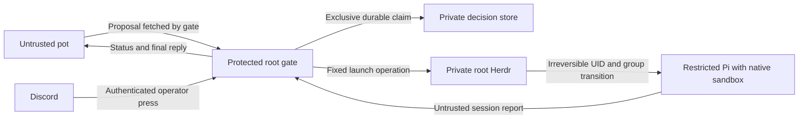
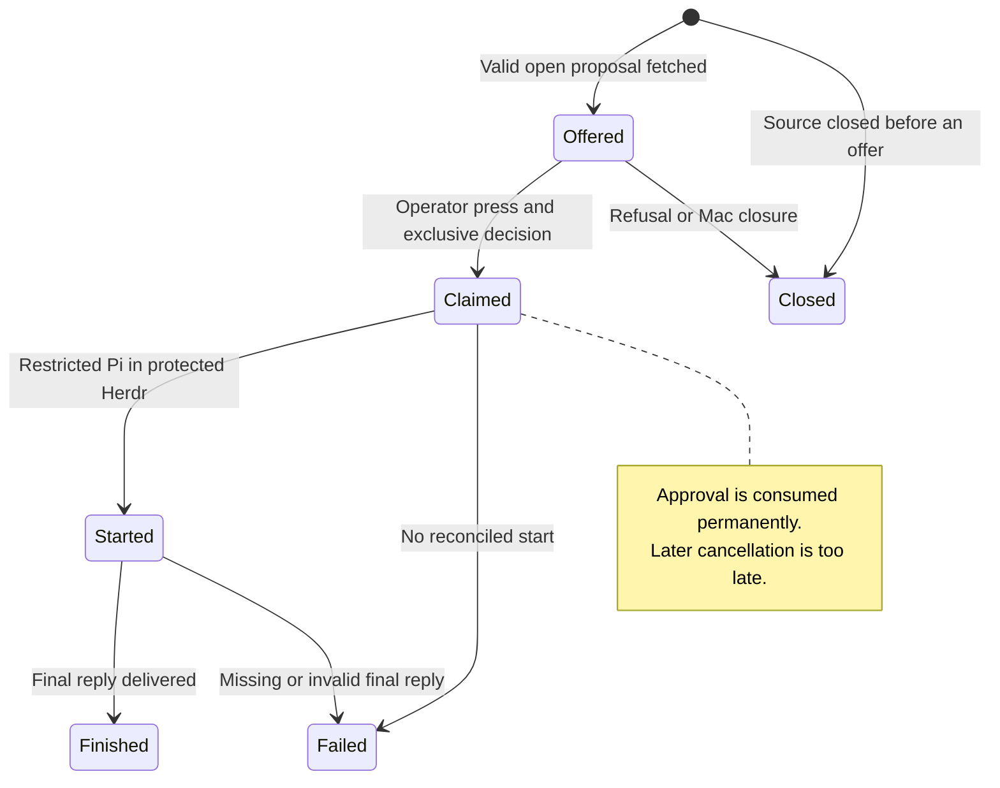

# Mac launch on the operator's own click

A pot proposes a prompt for a Mac. The Mac posts its exact bytes in Discord, and the operator's own click starts Pi in a restricted account inside a protected Herdr terminal. The requesting pot receives status and the final report.

Mac launches require the protected daemon. See the [installation procedure and native checks](mac-launch-install.md). There is no operator-user execution mode.

## Threat model



| Trusted principal | Untrusted principal |
| --- | --- |
| The root gate, its protected installed code/runtime, launchd configuration, private Herdr context and decision store | Every pot, Mastermind included, and every byte it sends |
| Discord for the account, application and message named by an authenticated interaction | Other Discord users and other applications' messages |
| The operator's Discord login, kept outside every pot and execution account | The launched Pi, its tools, selected work files, session log and later output |
| The operator/admin who stages the protected installation and explicit delegations | Project configuration, dependencies, hooks and instructions in an execution workspace |

A pot's model has that pot user's permissions. It can read its bot token and forge its local approval receipts. The Mac therefore treats a pot's message as a proposal. It never treats a pot-computed receipt as the operator's act.

The gate accepts only Discord's `INTERACTION_CREATE` event over its own authenticated outbound gateway connection. Each Mac has a separate Discord application and a dedicated token in the root-private gate directory. A pot token belongs to another application and cannot receive the gate application's interaction. Discord supplies the pressing user's ID. The gate compares it with the configured operator through the shared human-dialog contract.

The event must name the gate's own unedited offer, exact attachment, application, channel, target and prompt digest. The gate starts its saved prompt bytes. Its exclusive flushed decision makes replay ineffective. Old presses and claims expire independently, so sleeping or delayed startup cannot reuse approval indefinitely. Gateway reconnects do not resume missed interactions.

The operator's Discord session must never be available to a pot or execution account. Account takeover remains outside this boundary. Root/admin compromise and a compromised protected runtime remain outside it too.

## Separate execution authority

The gate runs as root in a system LaunchDaemon. Code, dependencies and every protected ancestor must be root-owned, without symlinks, group/world write permissions or extended ACL grants. The gate home is private. Its token, settings, offers, decisions and execution markers are private files. The execution account receives no gate descriptors or callable privileged service.

The root Herdr context has its own HOME, XDG directories, session and socket. It does not reuse the operator's Herdr configuration or SSH session. Pot transport uses only that private context's explicitly configured machines. The gate opens no inbound TCP port for pots.

Herdr starts one fixed wrapper with one launch ID. The wrapper requires root and reads that ID from the fixed protected store. It verifies the fresh claim and its execution configuration digest, writes an additional exclusive execution marker, and prepares a fresh run HOME. It accepts no command, executable, UID or path from a pot or Pi.

The wrapper clears supplementary groups, changes GID and UID irreversibly, and starts the protected Pi runtime through `/usr/bin/sandbox-exec`. It passes a rebuilt environment. No operator HOME, SSH agent, Herdr identity, browser login, vault session, signing key or model login is inherited. Pi resource auto-discovery and MCP are disabled for this path. Built-in tools remain available inside the native restrictions.

A model can create subprocesses within its already approved restricted work. It cannot create another gate-authorized launch, access the protected gate, or acquire the operator's identity. The sandbox remains mandatory for its descendants. A missing native mechanism fails closed.

### Selected work and delegated capabilities

The private configuration selects one execution-owned work directory under the execution work tree. Requests cannot choose another path. Each run also gets its own HOME and scratch directory under a root-owned parent. The native profile denies by default and exposes only selected work, the current run, protected tools and required system resources. It does not grant all of `/System`, whose Data volume contains user files.

A real model run requires an explicit dedicated API credential and selected network destinations. Supported model credential names are defined by the execution contract. Subscription and operator auth files are not copied. Delegated task credentials are separate private files, with an allowlist of environment names. Selected SSH config, key and known-hosts files may be copied into the fresh run HOME. Direct network connections are limited to the configured IPv4 destinations and ports for the capabilities declared by that request. The required explicit `system-dns` capability allows hostname queries through the macOS resolver, including arbitrary query names. DNS is a network channel and appears in the offer. Loopback and link-local metadata destinations are refused.

A configured Boat capability can supply its own token and API endpoints for `spend`. A publishing capability can supply its own scoped GitHub credential or selected SSH files and endpoints for `publish`. Only capabilities whose acts the request declares are handed over. The installer must verify each credential's scope and budget. A name in a manifest cannot narrow a broadly privileged credential.

Signing, gate modification, VM-root setup, pot restarts and credential administration have no supported privileged delegation and are refused. Workspace/Boat flows that require the operator's vault, local privileged Docker socket, unrestricted SSH or VM-root authority remain unavailable through this path. The failure must identify the missing capability. The gate never supplies those permissions as a fallback.

The offer shows the account, work directory, capability names, allowed network destinations, declared acts and cost. A change to the configured execution scope invalidates the earlier offer and claim. The marker-pattern act scan helps the operator read a request. It does not enforce the running model's permissions.

| Channel | Enforcement |
| --- | --- |
| Gate files, token and code | Root-private gate parent, protected ownership/modes and native ACL checks |
| Operator files and sessions | A separate non-login UID, fresh HOME, no inherited authority and default-deny native file/Mach access |
| Privilege escalation | No supplementary authority, no sudo delegation, no setuid launch helper and mandatory sandboxing |
| Process inspection | Separate identities and native default-deny policy, requiring native verification |
| Loader, shell and tool configuration | Protected runtime/code, fixed executables, rebuilt environments and no project code in privileged processes |
| Shared files or symlinks | Protected parent directories, exclusive run creation, no-follow bounded report reads and no shell evaluation of data |
| Network and control sockets | Explicit destinations, private gate socket, no operator socket or agent passed to the child |
| Child output | Untrusted report data only, never a command or approval |

## One Mac decision per launch



The Mac writes and flushes one exclusive decision before acting. Closure and claim compete for that same file. A later notice, source answer or press cannot reopen a decided launch. The second execution marker also prevents the privileged wrapper from starting the same claim twice.

Cancellation and replacement are requests until the Mac records their closure and reports it. A pot lists the request as open with `asked` set in the meantime. A claim that wins first stands, and the pot's start note includes `tooLate`. The gate does not kill a committed run or claim that it was cancelled.

The gate rechecks the source at the press. A closed source becomes a Mac closure. An outage starts nothing, leaves approval unused and gives the operator a private explanation. A pot that hides its cancellation cannot receive confirmation for it. A stale press also receives an explanation and consumes nothing.

The source expires locally if the Mac remains silent. A late start that the Mac validly claimed before expiry still reaches the pot with `tooLate`. The contract defines the time limits. Expiry notices and report delivery retry within their documented lifecycle.

### Restart and failure behavior

The root launch record retains the Herdr terminal identity, execution UID and exact session path. On gate restart the service resumes polling and delivery for that run. It does not start it again. A claim with no reconciled start remains consumed and reports failure with instructions to inspect the `ml-` terminal.

A final session is opened without following its last path component, checked for its execution owner, regular-file type, link count and byte limit, then parsed as JSON lines. A forged final reply is still only a reply. Invalid, oversized or substituted reports fail the run. Provider failures, length-limited turns and empty final replies also report failure.

A failed Discord edit cannot withhold a committed start from the pot. An unreadable record does not block other launches. Notice retries survive restart and stop at their deadline. Mismatched source answers are discarded. A Discord post whose response is lost can leave inert buttons on an earlier message. Only the saved message can authorize the launch.

An accepted replacement is not a transaction across the pot, Discord and Mac. A failed new announcement does not reopen an older closure. A new request and click are the recovery path.

Reports flow back through one fixed pot command with JSON on standard input. No mid-run instruction channel is provided. A new instruction needs a new prompt and click.

## Formats

All identifiers and credentials below are placeholders. The human-dialog contract owns validation, digest rules and operator policy.

### Pot configuration and commands

A pot can request launches on the targets listed in its private `sandbox.json`. Mastermind uses its configured Discord channel account and launch channel to post notices.

```json
{"macLaunch":{"targets":{"mac-studio":"Mac Studio","macbook-pro":"MacBook Pro"}}}
```

```sh
launch=/opt/agent-sandbox/session/mac-launch.mjs
node "$launch" request --target mac-studio --title "TITLE" [--acts spend] [--cost "TEXT"] [--replaces LAUNCH_ID] PROMPT_FILE
node "$launch" cancel LAUNCH_ID
node "$launch" list
node "$launch" announce REQUEST_ID
```

`request` saves the bytes and sends a notice through Mastermind's door. `announce` runs on Mastermind and posts that notice unchanged. Cancellation and replacement print `asked` with `effective: false` until the Mac reports closure. Prompts cannot start with `@` or `/`, which Pi interprets specially. The contract rejects invisible characters and oversized inputs.

### Notice and fetched request

The door request and Discord notice have this exact fixed text:

````text
Post this Mac launch notice with node /opt/agent-sandbox/session/mac-launch.mjs announce and this door request ID. Target mac-studio, pot accor.

```mac-launch
{"type":"mac.launch-notice","version":1,"launch":"LAUNCH_ID","pot":"accor","target":"mac-studio"}
```
````

A notice holds no prompt or approval. It tells the gate to fetch the proposal from that pot through its own private Herdr context. The gate calls `show LAUNCH_ID` and receives a packet of this shape:

```json
{"type":"mac.launch-request","version":1,"launch":"LAUNCH_ID","pot":"accor","target":"mac-studio","title":"Manage Boats","digest":"SHA256_OF_PROMPT_BYTES","acts":["spend"],"cost":"APPROVED_COST","createdAt":1794945000000,"expiresAt":1794946800000,"state":"open","prompt":"PROMPT_TEXT"}
```

### Offer, decision and report

The offer attaches the saved prompt as `prompt-DIGEST12.txt`. It names the restricted identity, work path, capabilities, network destinations, declared acts and cost. Launch and refusal buttons carry `ml:LAUNCH_ID:DIGEST` and `mx:LAUNCH_ID:DIGEST`. Closed offers retain their identity and final state, with no buttons or attachment.

The private decision under the gate's `launches` directory records the consumed press. `executionDigest` binds the protected execution configuration as well as the prompt:

```json
{"state":"claimed","decidedAt":1794945600000,"launch":"LAUNCH_ID","digest":"PROMPT_DIGEST","executionDigest":"EXECUTION_CONFIGURATION_DIGEST","target":"mac-studio","pot":"accor","interaction":"INTERACTION_ID","userId":"OPERATOR_ID","guildId":"GUILD","messageUrl":"https://discord.com/channels/GUILD/CHANNEL/OFFER_MESSAGE","at":"ISO_PRESS_TIMESTAMP"}
```

The gate sends a status packet to `status` through its private Herdr context, with JSON on standard input:

```json
{"type":"mac.launch-status","version":1,"launch":"LAUNCH_ID","target":"mac-studio","digest":"PROMPT_DIGEST","status":"finished","detail":"","messageUrl":"https://discord.com/channels/GUILD/CHANNEL/OFFER_MESSAGE","report":"FINAL_REPLY"}
```

The source validates the target and digest, stores the status and wakes its bot with `from` set to `mac-launch`. The final reply is bounded. Every terminal state consumes the approval, including failure. A new attempt needs a new request.

## Proof boundaries

`bin/check` includes operator/message/replay checks, claim-versus-closure recovery and configuration-scope invalidation. Run `node probes/mac-launch-isolation.mjs` separately on a host with Docker. It creates an owned disposable Linux container with no network, then exercises another numeric UID against fake operator/gate files and a protected dummy Herdr socket. It uses the shared identity-drop, environment and report-read code and creates no host account or permission grant. Keep this probe outside the factory check container, which has no Docker socket.

`node probes/mac-launch-runner.mjs` uses a separate real Herdr context and a stand-in Pi to prove launch identity, progress and final reporting. It tears down that context. No model or Mac is involved.

Linux proof does not establish Mac account isolation, ACL handling, sandbox compilation/inheritance, Keychain denial, launchd behavior, live Discord, provider connectivity, real Pi startup or GUI discovery. A process-environment attack was blocked by the harness environment-dump rule and was not run. Native `check` and the later clicked proof are mandatory. If a native mechanism fails, installation/activation fails with it. The [installation guide](mac-launch-install.md) identifies those checks and both Mac setup prompts.
