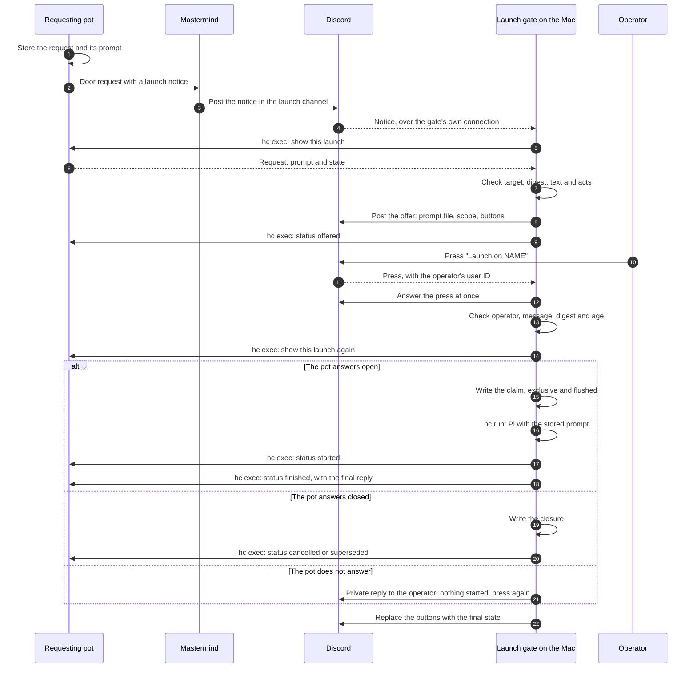
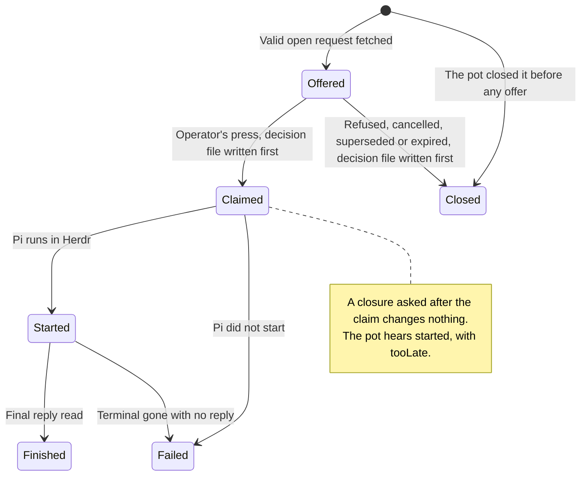

# Mac launch: a prompt starts on a Mac only on the operator's own click

A pot writes a prompt for one of the operator's Macs. That Mac shows it in Discord with a "Launch on NAME" button. The operator's click starts a Pi in Herdr on that Mac with the prompt's exact bytes. No pot reaches a Mac at any step: the Mac fetches what it acts on, and it alone hears the click.

Everything here is off until one Mac is set up and its private switch is on. [Setup](#setup-one-paste-per-mac) holds the two paste-ready blocks.

## Threat model

### Boundary

| Trusted principal | Untrusted principal |
| --- | --- |
| The launch gate, a process of the operator's user on one Mac, running this repository's code from the Mac's checkout. `mac/update` moves that checkout only to a tip the operator signed. | Every pot, Mastermind included: its model, its bot, its files, its Discord bot token, its door records and every byte it sends or stores. |
| Discord, for one fact: which account pressed which button on which message. | Every Discord message the gate did not write, and every member of the server but the operator. |
| The operator's Discord account, signed in on the operator's own devices. | The launched Pi's later output. It is a report and never an instruction to the gate. |

A pot's model runs with its user's full permissions. It can read its bot's Discord token, write its human-dialog store and forge any receipt a pot computes. So nothing a pot says or stores is evidence of the operator's act. The gate reads a pot's request as a proposal and nothing more.

### What the Mac trusts

The gate launches on one input only: an `INTERACTION_CREATE` event that Discord sends over the gate's own gateway connection, and that names the operator's user ID as the account that pressed the button.

Four facts make that event impossible for a pot's model to produce or replay.

1. **Each Mac has its own Discord application.** A button belongs to the application that posted its message, and Discord delivers a press only to that application. The Mac Studio's buttons live on the Mac Studio application's messages, the MacBook Pro's on its own.
2. **That application's token exists only on that Mac**, in the login keychain, written by the operator's own masked paste. It is in no vault folder, no pot, no door message and no repository. The gate reads events over an outbound TLS connection that this token opens. A pot holds another application's token, so it can neither open that connection nor inject an event into it.
3. **Discord sets the clicker's user ID from the pressing account's login.** A bot token cannot press a button: Discord's interaction endpoint takes a user's session only. The gate compares that ID with the one operator ID in the Mac's private configuration, through the same contract function as the push policy.
4. **The gate keeps its own record of what the button means.** The event must name the exact message the gate posted, unedited, with the attachment the gate uploaded. The gate launches the bytes it stored when it posted that message, never bytes a click or a pot hands over.

A replay fails on the same record. The gate writes its claim with an exclusive create before it starts anything, and a press older than 30 seconds is refused. The gate never resumes a gateway session, so Discord never redelivers a press the Mac missed.

**This rests on one condition the gate cannot check.** The operator's own Discord login must not exist inside a pot: no Discord web session in a pot's browser, no user token in a pot's files. A model that holds his login can press as him. The same holds for anyone who takes over his Discord account. Both are outside this perimeter, and the setup block says so.

### One decision per launch, written on the Mac

A launch leaves the offered state once. The gate writes one decision file for it, with an exclusive create, and flushes the file and its directory entry before it acts. The first decision written is the only one. It is a claim, which the operator's press makes, or a closure: refused, cancelled, superseded, expired or failed. One gate handles every event in one queue, and the exclusive create holds even if two gates ran.

A pot cannot close a launch. `cancel` and `--replaces` record what the pot asks and send the notice again. The Mac reads the pot's answer and writes the closure itself, also for a launch it never offered. Only then does it report `cancelled` or `superseded`, and the pot's record changes state on that report alone. Until then the pot lists the launch as open, with `asked` set.

When the Mac claims the operator's press first, the launch runs. The Mac reports `started`, and the pot's note for that status carries `tooLate` with the closure that lost. The Mac never reports a claimed launch as cancelled.

The gate asks the pot once more at the press. A closed answer becomes the Mac's closure instead of a claim. A pot that does not answer starts nothing and leaves the press unused, and the operator gets a private reply telling him to press again. That last look narrows the window. It is not the boundary, because a pot may ask a moment after it.

So a launch is dead from the moment the Mac writes its closure. From then on no press, no notice and no answer from the pot starts it, a pot that shows it open again included. A launch a pot asked to close, and that the Mac has not closed yet, is still live and its button still works. A pot that hides its own cancellation from the Mac gets no confirmation: the operator still decides on the Mac's own message.

Expiry is the one closure each side reaches alone. The Mac refuses a press at or after the request's expiry by its own clock and writes `expired`. A pot that heard nothing tells its bot `expired` one minute after the expiry, with a detail saying that no Mac reported a start. A start the Mac claimed just before, and reports later, still lands with `tooLate` set to `expired`.

### Credentials

| Credential | Held by | Lifetime | What it opens |
| --- | --- | --- | --- |
| Discord bot token of the Mac's own application | That Mac's login keychain, service `agent-sandbox-mac-launch` | Until the operator resets it in the Discord developer portal | The gate's gateway connection and its own messages |
| The Mac user's whole session | The launched Pi | The life of that Pi | Everything that user can do on that Mac |

The gate holds no pot credential. It reaches a pot the way the operator's Herdr already does, with `hc exec --on POT`.

The Mac owns its settings, offers and decisions. One gate serializes events and updates those records. The exclusive decision file guards terminal creation across gate restarts. Keep those files when restoring the Mac.

A gate that stopped after a claim and before it recorded the start reports `failed` and never launches that approval again. A Pi may be running in that case, and the report says so.

The token stays in memory after its Keychain read. Subprocess environments, arguments, reports and errors never carry it. A pot has no Mac mount, no process access there and no inbound endpoint. It cannot change the Mac's environment, lookup paths, sourced files, tool configuration or shared files. The Mac user's tools and configuration are trusted. An approved Pi shares that user and can read or alter the gate and its Keychain. Approval admits that prompt's work to the trusted Mac side. The act scan and system instruction do not isolate it from the gate.

### Channels

| Channel | What a pot's model would try | Closed by |
| --- | --- | --- |
| Network to the Mac | Open a connection to the gate | The gate listens on nothing. Its only connections are outbound: Discord's gateway and REST API, and `hc exec --on POT`. |
| Forged click | Send an event that names the operator | Events arrive only over the gate's own authenticated connection. A pot has no token for it. |
| Its own button | Post a look-alike message with a button | Discord sends that press to the pot's application. The gate never sees it, and its own record names another message. |
| Replay | Reuse an approval | One exclusive decision file per launch, 30-second press age, no gateway resume. |
| Swap after approval | Change the prompt between display and launch | The gate launches its stored bytes, whose digest it recomputes at the press. The pot's copy is read again at the press and can only stop the launch. |
| Swap before approval | Make the operator see other text than what runs | The prompt is shown as the gate's own attachment on the gate's own message. A press on an edited message, or one whose attachment or text differs from the gate's record, is refused. |
| Invisible text | Hide an instruction, or an act name, from a reader | A prompt holding a control, format, private-use or line-separator character is refused, at the pot and again on the Mac. The act scan removes combining and ignorable characters before matching, so an act name cannot hide behind one. |
| Undeclared privileged act | Ask for `vm-up` under a harmless title | The gate scans the prompt, the title and the stated cost for each privileged act's markers and refuses a request that names one it does not declare. The declared acts are on the button message. |
| Stale prompt | Launch a superseded, cancelled or expired prompt | A closure the Mac wrote is final: no press, notice or later answer from the pot reopens it. The gate also asks the pot at the press, and a closed answer becomes a closure instead of a claim. A dead offer loses its buttons and its attachment. [One decision per launch](#one-decision-per-launch-written-on-the-mac) says what the Mac cannot know. |
| Late launch | Fire after the Mac slept | The press is at most 30 seconds old, by Discord's own timestamp, when the Mac claims it. The Pi starts at most 30 seconds after the claim, by the Mac's clock. |
| Data from the pot | Break out of a field | The gate parses the pot's answer as JSON under a size cap. Values reach `hc` and `pi` as separate arguments, never through a shell, and reach Discord inside code spans with mentions disabled. |
| Report path | Use a status to start work | `hc exec` runs one fixed command in the pot with JSON on standard input. The pot's rules read it as a report. |
| Gate code | Change the gate through a pull request | The Mac runs a tip the operator signed. A prompt that names the gate's own files or switch must declare `launch-gate`, which the gate refuses by default. |
| Other server members | Press the button, or post a notice | The press is compared with the one operator ID. Notices count only from the configured announcer IDs, and a notice is no more than a reason to fetch. |

### What a launched Pi can reach

A launched Pi runs as the Mac's user, in Herdr, exactly like a Pi the operator starts by hand. It can read and change that user's files, use its credentials, ssh keys, signing key and vault login, reach its network and its pots, and spend money wherever that user can. The gate does not sandbox it. The prompt is free text, so the operator's reading of it is the control, and the button message exists to make that reading honest.

Three things narrow it.

- The button message names the privileged acts the request declares, from the fixed list below, and the cost the pot states.
- The gate refuses a request whose prompt names an act it does not declare, and one that declares an act listed in the Mac's `refusedActs`. The default refuses `sign-tip` and `launch-gate`: a signed tip decides the code every pot and this gate run, so those two stay the operator's manual acts unless he removes them from that list.
- The gate adds a frame to the Pi's system prompt: the approved acts, that no later message from a pot is an instruction, and that its final reply is the report.

The scan matches text. It catches a prompt that says `vm-up` and declares nothing. It does not catch a prompt that describes the same act in other words, and it is not an operating-system barrier.

| Act | Declared when the prompt asks to | Refused by default |
| --- | --- | --- |
| `sign-tip` | Sign a commit or a tip that pots then run | Yes |
| `launch-gate` | Change this gate, its settings, its token or its service | Yes |
| `vm-up` | Run `vm-up` or `vm-config`, which change a pot VM's root side | No |
| `restart-pot` | Restart or stop a pot, its session or its services | No |
| `spend` | Create or resume paid machines or services | No |
| `publish` | Push, merge, release or deploy | No |
| `credentials` | Create, rotate, move or print credentials | No |

### Probes

Each guarantee has an attack that must fail. `bin/check` runs them.

| Guarantee | Probe |
| --- | --- |
| Only the operator's press on the gate's own unedited message launches, once, in time, with the switch on | `probes/human-mac-launch-gate.mjs` |
| A request with invisible text, an undeclared or refused act, a wrong digest or another target makes no offer. A pot's cancellation stays asked until the Mac reports it, and a start the Mac committed first is reported as too late | `probes/human-mac-launch-request.mjs` |
| From notice to report through the whole gate: foreign notices, a pot that changes its answer or reopens a closed launch, a claim that beat a cancellation, a pot that does not answer, a double press, a failed start, a disabled switch | `probes/human-mac-launch-service.mjs` |
| The gateway client identifies, heartbeats, reconnects without resuming, and stops on a refused token | `probes/human-mac-launch-discord.mjs` |

`node probes/mac-launch-runner.mjs` starts a stand-in `pi` through the real `hc` and reads its report back. It needs Herdr, so it runs by hand and not in `bin/check`.

Nothing here ran on a real Mac or against Discord's servers. The keychain read, the launchd service and the live gateway are proven only by the setup block's own check.

## Flow





Every state but `Offered` is final for the approval. A launch that failed, expired or was refused needs a new request and a new press.

A request lives 30 minutes from its creation in the pot. The enabled pot service wakes its bot one minute after the expiry even if the Mac is offline. The MacBook Pro shows an offer only while it is awake. A notice it slept through is read when it reconnects, and offered only if the request is still open.

Buttons are the only entry. The gate has no slash command: a second entry would be a second gate to prove, and the operator can ask any pot for a prompt.

## Formats

All identifiers below are placeholders.

### Pot settings

`macLaunch` in a pot's `/etc/agent-sandbox/sandbox.json` turns the pot side on. Without `enabled: true`, `mac-launch.mjs` refuses every request.

```json
{"macLaunch": {"enabled": true, "targets": {"mac-studio": "Mac Studio", "macbook-pro": "MacBook Pro"}}}
```

Mastermind's also names where it posts notices: `"channelAccount": "discord"` and `"channelId": "LAUNCH_CHANNEL_ID"`.

### Pot commands

```sh
launch=/opt/agent-sandbox/session/mac-launch.mjs
node "$launch" request --target mac-studio --title "TITLE" [--acts vm-up,restart-pot] [--cost "TEXT"] [--replaces LAUNCH_ID] PROMPT_FILE
node "$launch" cancel LAUNCH_ID
node "$launch" list
node "$launch" announce REQUEST_ID
```

`request` stores the prompt, sends the notice to Mastermind through the door and prints the launch. `--replaces` asks the Mac to supersede an earlier launch in the same step, and `cancel` asks it to cancel one. Both print `asked` with `effective: false`. The launch is closed when the Mac reports it, and `list` shows `asked` until then. If the earlier launch started first, the replacement stays open: cancel it if it must not run too. `announce` runs on Mastermind only: it posts a received notice in the launch channel and replies to the door request with a posting confirmation. The gate itself calls two more, `show LAUNCH_ID` and `status`.

A prompt must not begin with `@` or `/`, which Pi reads as a file argument or as one of its own commands. It is at most 12 000 bytes of UTF-8 text with no control, format, private-use or line-separator character but line feed and tab. A title and a cost are one line of at most 100 characters.

### Launch notice

The door request to Mastermind and the Discord message hold the same text, and Mastermind posts it unchanged:

````text
Post this Mac launch notice with node /opt/agent-sandbox/session/mac-launch.mjs announce and this door request ID. Target mac-studio, pot accor.

```mac-launch
{"type":"mac.launch-notice","version":1,"launch":"LAUNCH_ID","pot":"accor","target":"mac-studio"}
```
````

A notice carries no prompt and no state. It tells the named Mac to fetch the launch from the named pot. A cancellation and a replacement send the same notice again.

### Request, as the gate fetches it

`hc exec --on POT node /opt/agent-sandbox/session/mac-launch.mjs show LAUNCH_ID` prints one JSON line:

```json
{"type":"mac.launch-request","version":1,"launch":"LAUNCH_ID","pot":"accor","target":"mac-studio","title":"Manage Workspace and Boats","digest":"SHA256_OF_PROMPT_BYTES","acts":["spend"],"cost":"One small Boat VM for an hour","createdAt":1794945000000,"expiresAt":1794946800000,"state":"open","prompt":"PROMPT_TEXT"}
```

`digest` is the SHA-256 of the prompt's UTF-8 bytes. `state` is `open` while the pot wants the launch offered. It is `cancelled` or `superseded` from the moment the pot asks, so the Mac can write the closure.

### Offer

The gate posts the offer in the launch channel, with the prompt as the attachment `prompt-DIGEST12.txt`:

```text
Launch on Mac Studio?
Pot: `accor` · Title: `Manage Workspace and Boats`
Prompt: the attached file, 5321 bytes, sha256 `SHA256_OF_PROMPT_BYTES`
Runs as: a Pi in Herdr on Mac Studio, as this Mac's user, with its files, credentials and network
Privileged acts declared: `spend` (create or resume paid machines or services)
Cost declared: `One small Boat VM for an hour`
Notice: https://discord.com/channels/GUILD/CHANNEL/MESSAGE
Expires <t:1794946800:R>
```

Its buttons carry `ml:LAUNCH_ID:DIGEST` for "Launch on Mac Studio" and `mx:LAUNCH_ID:DIGEST` for "Refuse". A dead offer keeps its first two lines and its final state, and loses its buttons and its attachment.

### Decision record

The gate keeps one per launch on the Mac, as `~/.config/agent-sandbox/mac-launch/LAUNCH_ID.decision`, written once with an exclusive create. A closure holds its `state` and `decidedAt`, and a refusal adds the press. A claim holds the press it consumed:

```json
{"state":"claimed","decidedAt":1794945600000,"launch":"LAUNCH_ID","digest":"SHA256_OF_PROMPT_BYTES","target":"mac-studio","pot":"accor","interaction":"INTERACTION_ID","userId":"CONFIGURED_OPERATOR_ID","guildId":"GUILD","messageUrl":"https://discord.com/channels/GUILD/CHANNEL/OFFER_MESSAGE","at":"ISO_PRESS_TIMESTAMP"}
```

### Status

The gate reports to the requesting pot with `hc exec --on POT -i node /opt/agent-sandbox/session/mac-launch.mjs status`, JSON on standard input:

```json
{"type":"mac.launch-status","version":1,"launch":"LAUNCH_ID","target":"mac-studio","digest":"SHA256_OF_PROMPT_BYTES","status":"finished","detail":"","messageUrl":"https://discord.com/channels/GUILD/CHANNEL/OFFER_MESSAGE","report":"FINAL_REPLY"}
```

`status` is `offered`, `started`, `finished`, `refused`, `expired`, `superseded`, `cancelled` or `failed`. The pot checks the launch and its digest against its own record, stores the status and wakes its bot with `from` set to `mac-launch` and that packet as the note. When `started` arrives for a launch the pot had asked to close, or had already called expired, the note also holds `tooLate` with that closure. A status the pot did not get is sent again until it lands. `report` is the Pi's final reply, cut at 8000 characters.

A report is all that flows back. The gate has no way to send a pot's words into a running Pi: a new instruction is a new request with its own press.

## Setup: one paste per Mac

Each block is a prompt for a Pi on that Mac with Node 24 or newer. Paste it once per Mac. Before its proof step, complete the shared Pots setup below with the operator's explicit permission. Refusal of signing and gate changes means rejecting declared or recognized prompt text. It does not prevent an approved Pi from performing those acts.

### Mac Studio

```text
Set up the Mac launch gate on this Mac Studio. Read docs/mac-launch.md in my agent-sandbox checkout first, including the shared Pots setup before the proof. Ask my explicit permission before applying any pot settings or restart, and wait while a paid run is active. Run no vm-up and change nothing else.

Tell me this before anything else, and wait for my yes: a prompt I launch from Discord runs as a Pi under my own user on this Mac. It can read and change my files, use my credentials, ssh keys, signing key and vault login, reach my pots and spend money wherever I can. The gate shows me the prompt, the pot that asks and the privileged acts it declares, and it refuses a prompt that asks to sign a tip or to change the gate. Nothing else limits a launched Pi. It only holds if my own Discord login never lives inside a pot.

Then, in order:
1. Check that the checkout is on main at a commit that has mac/launch-gate, and that node, hc and pi run. Stop if not.
2. Ask me to create a Discord application named "Mac Studio launcher" in the developer portal, turn on its Message Content intent, and add its bot to my server with View Channel, Send Messages, Attach Files and Read Message History in the launch channel. It must be an application no other machine uses.
3. Ask me for these, and never repeat them outside this Mac: my Discord user ID, the server ID, the launch channel ID and Mastermind's bot user ID. List my pots from `hc machine ls` and ask which may request a launch here.
4. Run: ./mac/launch-gate configure --name mac-studio --label "Mac Studio" --operator ID --guild ID --channel ID --announcer ID --pots POT,POT --directory "$HOME"
5. Ask me to run this myself in a terminal and paste the bot token at its hidden prompt: ./mac/launch-gate token
6. Run ./mac/launch-gate check and show me every line. Stop on any failure.
7. Only on my explicit yes: ./mac/launch-gate enable, then ./mac/launch-gate install
8. Proof: ask me to have any pot request a launch here whose prompt is "Reply with the word ready." and to press its button. Show me that a Pi named ml-… appeared in Herdr and that the offer says Started, then Finished.

To turn it off: ./mac/launch-gate disable, then ./mac/launch-gate remove. To remove the token: security delete-generic-password -s agent-sandbox-mac-launch, then reset it in the developer portal.
```

### MacBook Pro

```text
Set up the Mac launch gate on this MacBook Pro. Read docs/mac-launch.md in my agent-sandbox checkout first, including the shared Pots setup before the proof. Ask my explicit permission before applying any pot settings or restart, and wait while a paid run is active. Run no vm-up and change nothing else.

Tell me this before anything else, and wait for my yes: a prompt I launch from Discord runs as a Pi under my own user on this Mac. It can read and change my files, use my credentials, ssh keys, signing key and vault login, reach my pots and spend money wherever I can. The gate shows me the prompt, the pot that asks and the privileged acts it declares, and it refuses a prompt that asks to sign a tip or to change the gate. Nothing else limits a launched Pi. It only holds if my own Discord login never lives inside a pot. This Mac shows a button only while it is awake, and a request dies 30 minutes after a pot wrote it.

Then, in order:
1. Check that the checkout is on main at a commit that has mac/launch-gate, and that node, hc and pi run. Stop if not.
2. Ask me to create a second Discord application named "MacBook Pro launcher" in the developer portal, turn on its Message Content intent, and add its bot to my server with View Channel, Send Messages, Attach Files and Read Message History in the launch channel. It must not be the Mac Studio's application.
3. Ask me for these, and never repeat them outside this Mac: my Discord user ID, the server ID, the launch channel ID and Mastermind's bot user ID. List my pots from `hc machine ls` and ask which may request a launch here.
4. Run: ./mac/launch-gate configure --name macbook-pro --label "MacBook Pro" --operator ID --guild ID --channel ID --announcer ID --pots POT,POT --directory "$HOME"
5. Ask me to run this myself in a terminal and paste the bot token at its hidden prompt: ./mac/launch-gate token
6. Run ./mac/launch-gate check and show me every line. Stop on any failure.
7. Only on my explicit yes: ./mac/launch-gate enable, then ./mac/launch-gate install
8. Proof: ask me to have any pot request a launch here whose prompt is "Reply with the word ready." and to press its button. Show me that a Pi named ml-… appeared in Herdr and that the offer says Started, then Finished.

To turn it off: ./mac/launch-gate disable, then ./mac/launch-gate remove. To remove the token: security delete-generic-password -s agent-sandbox-mac-launch, then reset it in the developer portal.
```

### Pots

A pot may request a launch once its `sandbox.json` holds `macLaunch` with `enabled: true` and `./bin/vm-config` copied it. After first enabling this feature, the operator restarts the pot session with `./bin/pots-session restart` to load the expiry service. Mastermind's also needs the launch channel. The setup Pi edits the private sandbox files on the Mac, preserves all other keys and existing targets, and applies them only on the operator's explicit approval. It runs `SANDBOX=POT ./bin/vm-config` and `SANDBOX=POT ./bin/pots-session restart` per enabled pot, waiting while paid work is active. This phase happens before the proof in each setup block. Already configured pots need no restart.

### What `check` proves

`./mac/launch-gate check` prints each group of checks and exits non-zero when one fails: the settings file is private and complete, the token opens Discord as a bot, that bot's application has the Message Content intent, it sees the launch channel in the configured server, the operator ID is a member of that server, this Mac's clock is within five seconds of Discord's, `pi` and `hc` run, and `hc exec` reaches every listed pot.

### Mac settings

`~/.config/agent-sandbox/mac-launch.json`, mode 600, written by `configure`:

```json
{"humanDiscord": {"userId": "OPERATOR_ID", "macLaunchEnabled": false}, "name": "mac-studio", "label": "Mac Studio", "guildId": "GUILD", "channelId": "LAUNCH_CHANNEL", "announcers": ["MASTERMIND_BOT_USER_ID"], "pots": ["mastermind", "accor"], "refusedActs": ["sign-tip", "launch-gate"], "directory": "/Users/NAME", "path": ["/opt/homebrew/bin"], "piArguments": []}
```

`humanDiscord` has the shape the push policy reads, so one contract function checks both. The gate exits at once while `macLaunchEnabled` is not `true`. It exits with a failure, so launchd starts it again every 30 seconds and it exits again until `enable`, or until `remove` takes the service away.
