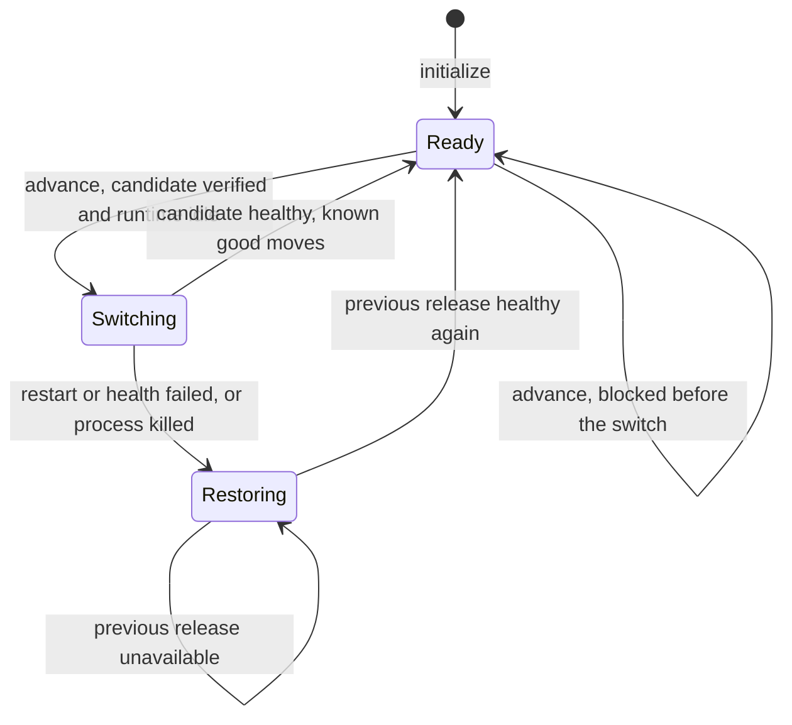

# Managed receiver

The receiver stages a Factory-signed candidate, asks a runtime adapter to switch releases, and keeps the previous healthy release for recovery. The scheduled service uses the operator-signed updater until the VM has an enrolled receiver.



`dispatch` runs only in `Ready` with the loaded release equal to the known-good release. Any other phase answers `admission-closed`.

## Layout

| Entry in `RECEIVER` | Holds |
| --- | --- |
| `checkout/`, `trusted-signers.asc`, `candidate.git/`, `source` | The preflight inputs described in [managed update preflight](managed-update-preflight.md). |
| `releases/REVISION/` | One protected checkout per candidate, materialized by `poll` after verification. |
| `factory-signers.asc` | Public keys the Factory signer may use. The operator key file never authorizes a Factory landing. |
| `runtime` | Adapter executable for the standalone receiver command. It takes `idle`, `restart`, `health` or `dispatch`, then the checkout path, the revision and extra arguments. The installed VM path uses `VmSession` instead. |
| `control/` | The admission lock, receiver status and per-release revision markers. The session mounts it read-only. |

## Candidate rule

`python3 -I lib/managed_update.py RECEIVER agent-sandbox COMMIT --factory` and `advance` both call `verify_publication` in `lib/factory_candidate.py`. It accepts a candidate only when all of these hold.

- A key in `factory-signers.asc` signed the commit.
- The commit message is `Factory landing v1` followed by canonical JSON naming this repository, `refs/heads/main`, the PR number, the review generation, the head, the base and the tree.
- The checked base is the preceding verified release, starting with the receiver's known-good commit. The candidate's sole parent equals that base under [the producer contract](https://github.com/walid-mos/agent-sandbox/blob/87bd84d9f0a8a19a49938a81ab4d965cf8895675/docs/factory-release-fixture.md).
- The base is an ancestor of the head, and the head and the candidate share the signed tree.

The receiver derives its decision from the protected keyring, signed commit, and Git objects. The producer's JSON export supplies test assertions. The current verifier covers the single-parent `Factory landing v1` contract. The production history decision and GitHub merge state remain with the Factory publisher.

## Activation

`python3 -I lib/managed_receiver.py RECEIVER poll` takes the exclusive admission lock and fetches `main` from the configured origin into `candidate.git`. It derives the checkpoints from the first-parent chain back to known good and verifies them oldest first. It fetches `refs/tags/factory-reviewed/CANDIDATE` for each checkpoint and compares the tag's direct Git object ID with the signed reviewed head. A missing or invalid checkpoint blocks the entire series before any switch. Once the series verifies, the receiver loads each checkpoint in order. If a switch fails, the next poll retries from the last healthy checkpoint. `advance REVISION` also accepts a pre-staged checkout under the same lock.

1. Check the known-good release and its health.
2. Verify the candidate, then the `releases/REVISION` checkout and its tree.
3. Ask the runtime whether work is idle. A busy runtime stops here with `runtime-busy` and changes nothing, so a later run retries.
4. Record `switching`, restart the named consumers on the candidate, and require a health report that names the candidate as loaded.
5. On failure, record `restoring`, restart the known-good release and require its health. The previous checkout is never modified.

`dispatch` takes the lock shared, so it cannot start during a switch, and it re-checks health before handing the call to the runtime. A killed process leaves `switching`. The next `advance` restores the known-good release before anything else.

## Status

`status` reports `phase`, `accepted` (the accepted checkpoint), `known_good` (the rollback pointer), `filesystem`, `loaded`, `desired`, `verified` and `blocked`. It reports `loaded` only in `ready` and only after a fresh health report for the known-good release. A failed rollback keeps admission closed and records `recovery_failure` alongside the original `blocked` reason. While another process holds the exclusive lock, `status` reports `admission-busy`.

| Block | Meaning |
| --- | --- |
| `runtime-busy` | Work has not reached a safe checkpoint. |
| `gateway-drain-unavailable` | The installed gateway cannot hold new turns during the switch. The verified candidate stays pending and the running release stays available. |
| `runtime-health-failed`, `runtime-version-mismatch`, `runtime-restart-failed` | The runtime failed a check. The phase distinguishes completed recovery from a switch or recovery still pending. |
| `activation-interrupted` | A previous process died mid-switch. |
| `factory-*` | The signed landing did not match the rule above. |
| `candidate-checkpoint-mismatch` | The candidate is not the known-good release or its accepted successor. |

## Proof

```sh
python3 -B probes/factory-receiver.py
FACTORY_RELEASE_EXPORT=DIRECTORY python3 -B probes/factory-producer-receiver.py
```

The first command uses disposable keys and a simulated runtime. It covers signature and tree refusal, idle retry, health disagreement, rollback and recovery after a killed receiver. Set `FACTORY_RELEASE_REVISION` to exercise the dispatcher from a reviewed source commit. The second command imports the original single-release export into a disposable Git remote and maps its PR head ref to the candidate-keyed tag. Set `FACTORY_RELEASE_DISPATCH=1` only with an export whose signed tree contains the reviewed dispatcher probes. Set `FACTORY_RELEASE_SERIES=DIRECTORY` and run `python3 -B probes/factory-receiver-series.py` for the three-checkpoint producer export.

For the push-policy cutover, run the first command with `FACTORY_RELEASE_DISPATCH_BASE=512e4f16b4c8fa206d67b69331e7ec175b1d5ed9` and `FACTORY_RELEASE_REVISION=67584ad6dbf10ee3149948c92b858afde7df7582`. The probe runs the dispatcher and queue against both exact source trees, uses a local Git remote for bootstrap pushes, and captures the Pi launch arguments. It checks the policy reference for fresh workers and the extra client-rules reference when configured. Resume opens the original session file. Set `FACTORY_RELEASE_REQUIRE_RESUME_POLICY=1` with a candidate that includes the launch fix to require the current push-policy reference in both fresh and resumed Pi startup arguments. The case then scripts two ordinary pushes to the local remote. The broker tests exercise two separate exact client receipts.

Before declaring the signed rollout verified, resume a worker whose saved session predates the policy, with a routine topic-branch commit waiting to push. Confirm that it reads the policy from the loaded release, that the expected commit reaches the remote, and that the broker records no push question. Repeat with a fresh worker. In a client-rules pot, check that two successive pushes each get their own scoped question and neither reaches the remote before its approval. The disposable fixture ends at Pi startup and bootstrap publication.

## Installed integration

`bin/vm-trust` installs the files in `vm/trusted-bundle`. The timer runs the installed launcher's `scheduled` operation, and the keeper runs `keep`. The operator-signed clone remains the source of commands that run as host root. Once enrolled, the receiver selects a verified checkout and mounts it and its service definitions read-only at the existing session paths. Docker binds these paths directly. SealSkin receives the same binds in its app template before relaunch.

Both the update service and keeper take the receiver's exclusive lock before restarting the session. Fresh and resumed workers, including watcher recovery, take a shared lock through terminal creation. Clean passes use the same gate. The gate compares the mounted revision with the ready receiver state. A deferred worker stays in the queue. The installed adapter checks Docker's read-only mount sources and requires the gateway, router, watcher and sources processes to report the selected revision. It also requires a successful unauthenticated HTTP response from Magpie on loopback. The keeper records `restoring` before a repair and waits for the same health checks after restarting the router or the session. If readiness times out, admission remains closed. After a router-only timeout, the next poll checks full health and can restart only the router on the selected known-good release. The poll reopens admission once full health returns.

`FACTORY_RELEASE_EXPORT=DIRECTORY python3 -B probes/factory-installed-receiver.py` installs the manifest in a disposable directory and invokes the update and keeper unit commands. The probe uses the signed export for Git fetch, a loopback HTTP listener for readiness, and a stand-in for Docker and s6. It exercises the installed gateway stop point and substitutes an already-drained gateway for the cases that switch releases.

### Production cutover

Enrollment needs an authorized operator-signed anchor containing the integrated code and a separate Factory public key. The protected receiver layout, including the anchor checkout and bare candidate repository, must exist before running the installed launcher's `initialize-receiver` operation. Install and test the initial managed mount before enabling Factory publication. Native Docker or SealSkin startup must verify s6 process revision reports and the worker publication checks above. Mac, Pi, Herdr, overlays and other repositories stay outside the Factory signer scope.

Pots 0.8.5 can report an idle snapshot and restart its service. Its upstream, [Crokily/pi-durable-bot](https://github.com/Crokily/pi-durable-bot), exposes no supported operation to hold incoming turns while active ones drain. The installed receiver therefore reports `gateway-drain-unavailable` after candidate verification and the idle checks, before altering the loaded release. A later poll repeats verification and leaves admission open for the currently loaded release.

For a separately authorized manual cutover, the smallest operator step would be to stop the gateway after checking it is idle, switch under exclusive admission while it is stopped, then start it against the selected release and verify health before reopening admission. This would rely on each chat platform retaining events during the gap. Whether the installed gateway resumes from the same platform offsets or cursors is unverified. A turn arriving while it is stopped could be delayed or lost.
