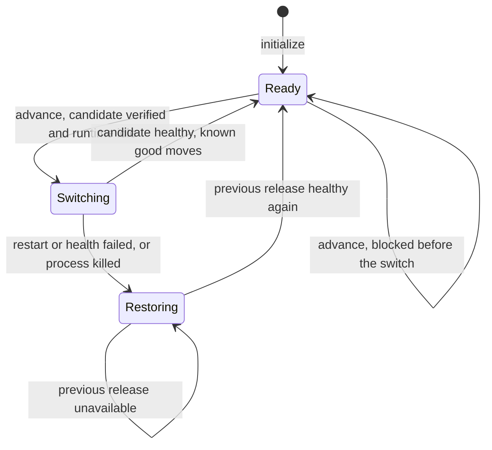

# Managed receiver

The receiver stages a Factory-signed candidate, asks a runtime adapter to switch releases, and keeps the previous healthy release for recovery. The VM uses its existing operator-signed updater until the installed integration described below is complete.



`dispatch` runs only in `Ready` with the loaded release equal to the known-good release. Any other phase answers `admission-closed`.

## Layout

| Entry in `RECEIVER` | Holds |
| --- | --- |
| `checkout/`, `trusted-signers.asc`, `candidate.git/`, `source` | The preflight inputs described in [managed update preflight](managed-update-preflight.md). |
| `releases/REVISION/` | One protected checkout per candidate, materialized by `poll` after verification. |
| `factory-signers.asc` | Public keys the Factory signer may use. The operator key file never authorizes a Factory landing. |
| `runtime` | Executable owned by the receiver account. It takes `idle`, `restart`, `health` or `dispatch`, then the checkout path, the revision and extra arguments. |
| `status.json`, `admission.lock` | Receiver state and the admission lock. |

## Candidate rule

`python3 -I lib/managed_update.py RECEIVER agent-sandbox COMMIT --factory` and `advance` both call `verify_publication` in `lib/factory_candidate.py`. It accepts a candidate only when all of these hold.

- A key in `factory-signers.asc` signed the commit.
- The commit message is `Factory landing v1` followed by canonical JSON naming this repository, `refs/heads/main`, the PR number, the review generation, the head, the base and the tree.
- The checked base is the installed release. `require_landing_parents` applies the `Factory landing v1` rule in [the producer contract](https://github.com/walid-mos/agent-sandbox/blob/57fd8666a01751eda806fce5fa3d231ba466b062/docs/factory-release-fixture.md).
- The base is an ancestor of the head, and the head and the candidate share the signed tree.

The receiver derives its decision from the protected keyring, signed commit, and Git objects. The producer's JSON export is fixture evidence. The current verifier covers the pinned single-parent `Factory landing v1` fixture. GitHub merge state and the production candidate shape remain part of the Factory publication decision.

## Activation

`python3 -I lib/managed_receiver.py RECEIVER poll` takes the exclusive admission lock. It fetches `main` from the configured HTTPS origin into `candidate.git`. When the signed review head is missing, it fetches the PR head and verifies the full ID named by the signature. It verifies before placing a new checkout and uses `advance` to switch. `advance REVISION` also accepts a pre-staged checkout under the same lock.

1. Check the known-good release and its health.
2. Verify the candidate, then the `releases/REVISION` checkout and its tree.
3. Ask the runtime whether work is idle. A busy runtime stops here with `runtime-busy` and changes nothing, so a later run retries.
4. Record `switching`, restart the named consumers on the candidate, and require a health report that names the candidate as loaded.
5. On failure, record `restoring`, restart the known-good release and require its health. The previous checkout is never modified.

`dispatch` takes the lock shared, so it cannot start during a switch, and it re-checks health before handing the call to the runtime. A killed process leaves `switching`. The next `advance` restores the known-good release before anything else.

## Status

`status` reports `phase`, `accepted` (the accepted checkpoint), `known_good` (the rollback pointer), `filesystem`, `loaded`, `desired`, `verified` and `blocked`. It reports `loaded` only in `ready` and only after a fresh health report for the known-good release. A failed rollback keeps admission closed and records `recovery_failure` alongside the original `blocked` reason. While another process holds the exclusive lock, `status` reports `admission-busy`.

| Block | Meaning |
| --- | --- |
| `runtime-busy` | Work has not reached a safe checkpoint. |
| `runtime-health-failed`, `runtime-version-mismatch`, `runtime-restart-failed` | The runtime failed a check. The phase distinguishes completed recovery from a switch or recovery still pending. |
| `activation-interrupted` | A previous process died mid-switch. |
| `factory-*` | The signed landing did not match the rule above. |
| `candidate-checkpoint-mismatch` | The candidate is not the known-good release or its accepted successor. |

## Proof

```sh
python3 -B probes/factory-receiver.py
FACTORY_RELEASE_EXPORT=DIRECTORY python3 -B probes/factory-producer-receiver.py
```

The first command uses disposable keys and a simulated runtime. It covers signature and tree refusal, idle retry, health disagreement, rollback and recovery after a killed receiver. Set `FACTORY_RELEASE_REVISION` to exercise the dispatcher from a reviewed source commit. The second command uses the producer export as the fetch source and covers activation, interruption, rollback and signature refusal. Set `FACTORY_RELEASE_DISPATCH=1` only with an export whose signed tree contains the reviewed dispatcher probes.

For the push-policy cutover, run the first command with `FACTORY_RELEASE_DISPATCH_BASE=512e4f16b4c8fa206d67b69331e7ec175b1d5ed9` and `FACTORY_RELEASE_REVISION=67584ad6dbf10ee3149948c92b858afde7df7582`. The probe runs the dispatcher and queue against both exact source trees, uses a local Git remote for bootstrap pushes, and captures the Pi launch arguments. It checks the policy reference for fresh workers and the extra client-rules reference when configured. Resume opens the original session file. The launch arguments show whether resume passes any new prompt text.

Before declaring the signed rollout verified, resume a worker whose saved session predates the policy, with a routine topic-branch commit waiting to push. Confirm that it reads the policy from the loaded release, that the expected commit reaches the remote, and that the broker records no push question. Repeat with a fresh worker. In a client-rules pot, check that two successive pushes each get their own scoped question and neither reaches the remote before its approval. The disposable fixture ends at Pi startup and bootstrap publication.

## Installed integration

| Source owner | Remaining file or interface | Checked restriction |
| --- | --- | --- |
| #53 with #30 | `vm/pots-update.service`, `bin/vm-trust`, `lib/trusted_source.py` | The timer invokes the installed operator-only updater. The install bundle lacks the receiver. #30 also changes the installer and launcher. Replace the timer path at cutover and keep Factory trust confined to the receiver. |
| #53 with the VM runtime owner | `bin/render-config`, `bin/pots-session`, `vm/keeper`, `session/services.d/` | Docker and SealSkin mount the fixed clone and its service definitions. The keeper can start a container or restart the router. The runtime adapter needs a release selection used by both launchers, a guarded restart path, and loaded-revision reports from gateway, watcher, router and sources. |
| #53 with the worker runtime owner | `session/workers.mjs`, `session/serve-queue.mjs`, `session/clean-pass.mjs` and the terminal supervisor | Fresh workers and resumes share `launch`, and both that path and clean passes call `openTerminal`. They call `hc` directly today. The shared gate must cover these launches and supervisor-initiated restarts. A blocked queued start must remain queued. The exclusive VM check needs a reliable inventory of active work and dialogs before switching. |
| #30 with #53 | Factory publication and receiver fetch | This version polls one release whose base equals the known-good checkout. Skipped releases fail closed. The supported workflow still needs ordered adoption of missed landings, with verified review objects and no bypass of a failed checkpoint. |

The installed integration needs an authorized operator-signed anchor and separately scoped Factory enrollment. Mac, Pi, Herdr, overlays and other repositories remain outside the Factory receiver policy.
