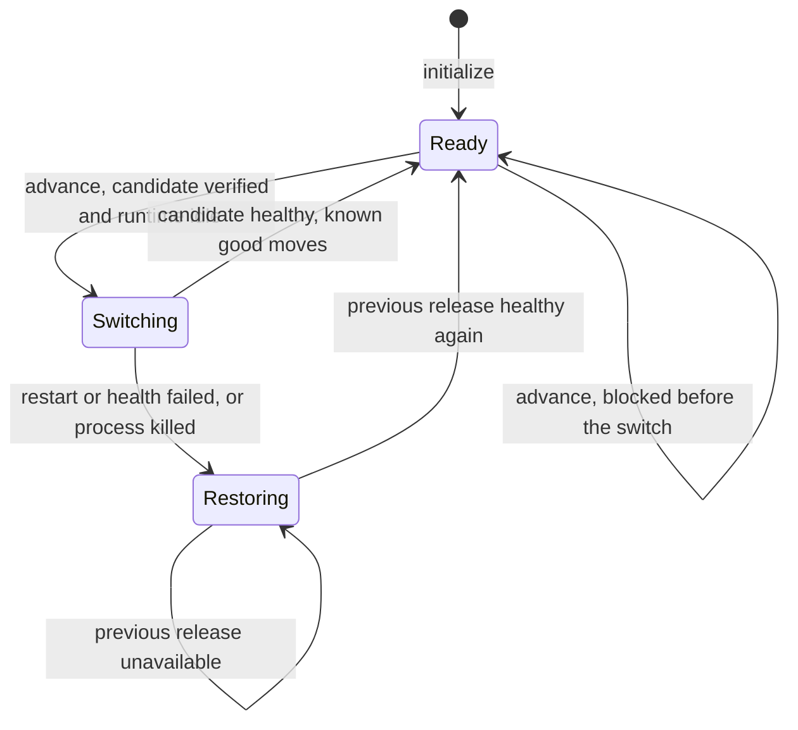

# Managed receiver

The receiver stages a Factory-signed candidate, asks a runtime adapter to switch releases, and keeps the previous healthy release for recovery. The scheduled service uses the operator-signed updater until the VM has an enrolled receiver.



`dispatch` runs only in `Ready` with the loaded release equal to the known-good release. Any other phase answers `admission-closed`.

## Layout

| Entry in `RECEIVER` | Holds |
| --- | --- |
| `checkout/`, `trusted-signers.asc`, `candidate.git/`, `source` | The preflight inputs described in [managed update preflight](managed-update-preflight.md). |
| `releases/REVISION/` | One protected checkout per candidate, materialized by `poll` after verification. |
| `factory-signers.asc` | Public keys the Factory signer may use. The operator key file never authorizes a Factory landing. |
| `runtime` | Adapter executable for the standalone receiver command. It takes `idle`, `restart`, `health` or `dispatch`, then the checkout path, the revision and extra arguments. The installed VM path uses `VmSession` instead. |
| `control/` | The admission lock, receiver status and per-release revision markers. The session mounts it read-only. |

## Candidate rule

`python3 -I lib/managed_update.py RECEIVER agent-sandbox COMMIT --factory` and `advance` both call `verify_publication` in `lib/factory_candidate.py`. It accepts a candidate only when all of these hold.

- A key in `factory-signers.asc` signed the commit.
- The commit message is `Factory landing v1` followed by canonical JSON naming this repository, `refs/heads/main`, the PR number, the review generation, the head, the base and the tree.
- The checked base is the installed release. `require_landing_parents` applies the `Factory landing v1` rule in [the producer contract](https://github.com/walid-mos/agent-sandbox/blob/57fd8666a01751eda806fce5fa3d231ba466b062/docs/factory-release-fixture.md).
- The base is an ancestor of the head, and the head and the candidate share the signed tree.

The receiver derives its decision from the protected keyring, signed commit, and Git objects. The producer's JSON export is fixture evidence. The current verifier covers the pinned single-parent `Factory landing v1` fixture. GitHub merge state and the production candidate shape remain part of the Factory publication decision.

## Activation

`python3 -I lib/managed_receiver.py RECEIVER poll` takes the exclusive admission lock. It fetches `main` from the configured HTTPS origin into `candidate.git`. When the signed review head is missing, it fetches the PR head and verifies the full ID named by the signature. It verifies before placing a new checkout and uses `advance` to switch. `advance REVISION` also accepts a pre-staged checkout under the same lock.

1. Check the known-good release and its health.
2. Verify the candidate, then the `releases/REVISION` checkout and its tree.
3. Ask the runtime whether work is idle. A busy runtime stops here with `runtime-busy` and changes nothing, so a later run retries.
4. Record `switching`, restart the named consumers on the candidate, and require a health report that names the candidate as loaded.
5. On failure, record `restoring`, restart the known-good release and require its health. The previous checkout is never modified.

`dispatch` takes the lock shared, so it cannot start during a switch, and it re-checks health before handing the call to the runtime. A killed process leaves `switching`. The next `advance` restores the known-good release before anything else.

## Status

`status` reports `phase`, `accepted` (the accepted checkpoint), `known_good` (the rollback pointer), `filesystem`, `loaded`, `desired`, `verified` and `blocked`. It reports `loaded` only in `ready` and only after a fresh health report for the known-good release. A failed rollback keeps admission closed and records `recovery_failure` alongside the original `blocked` reason. While another process holds the exclusive lock, `status` reports `admission-busy`.

| Block | Meaning |
| --- | --- |
| `runtime-busy` | Work has not reached a safe checkpoint. |
| `runtime-health-failed`, `runtime-version-mismatch`, `runtime-restart-failed` | The runtime failed a check. The phase distinguishes completed recovery from a switch or recovery still pending. |
| `activation-interrupted` | A previous process died mid-switch. |
| `factory-*` | The signed landing did not match the rule above. |
| `candidate-checkpoint-mismatch` | The candidate is not the known-good release or its accepted successor. |

## Proof

```sh
python3 -B probes/factory-receiver.py
FACTORY_RELEASE_EXPORT=DIRECTORY python3 -B probes/factory-producer-receiver.py
```

The first command uses disposable keys and a simulated runtime. It covers signature and tree refusal, idle retry, health disagreement, rollback and recovery after a killed receiver. Set `FACTORY_RELEASE_REVISION` to exercise the dispatcher from a reviewed source commit. The second command uses the producer export as the fetch source and covers activation, interruption, rollback and signature refusal. Set `FACTORY_RELEASE_DISPATCH=1` only with an export whose signed tree contains the reviewed dispatcher probes.

For the push-policy cutover, run the first command with `FACTORY_RELEASE_DISPATCH_BASE=512e4f16b4c8fa206d67b69331e7ec175b1d5ed9` and `FACTORY_RELEASE_REVISION=67584ad6dbf10ee3149948c92b858afde7df7582`. The probe runs the dispatcher and queue against both exact source trees, uses a local Git remote for bootstrap pushes, and captures the Pi launch arguments. It checks the policy reference for fresh workers and the extra client-rules reference when configured. Resume opens the original session file. Set `FACTORY_RELEASE_REQUIRE_RESUME_POLICY=1` with a candidate that includes the launch fix to require the current push-policy reference in both fresh and resumed Pi startup arguments. The case then scripts two ordinary pushes to the local remote. The broker tests exercise two separate exact client receipts.

Before declaring the signed rollout verified, resume a worker whose saved session predates the policy, with a routine topic-branch commit waiting to push. Confirm that it reads the policy from the loaded release, that the expected commit reaches the remote, and that the broker records no push question. Repeat with a fresh worker. In a client-rules pot, check that two successive pushes each get their own scoped question and neither reaches the remote before its approval. The disposable fixture ends at Pi startup and bootstrap publication.

## Installed integration

`bin/vm-trust` installs the files in `vm/trusted-bundle`. The timer runs the installed launcher's `scheduled` operation, and the keeper runs `keep`. The operator-signed clone remains the source of commands that run as host root. Once enrolled, the receiver selects a verified checkout and mounts it and its service definitions read-only at the existing session paths. Docker binds these paths directly. SealSkin receives the same binds in its app template before relaunch.

Both the update service and keeper take the receiver's exclusive lock before restarting the session. Fresh and resumed workers, including watcher recovery, take a shared lock through terminal creation. Clean passes use the same gate. The gate compares the mounted revision with the ready receiver state. A deferred worker stays in the queue. The installed adapter checks Docker's read-only mount sources and requires the gateway, router, watcher and sources service processes to report the selected revision in their environment.

`FACTORY_RELEASE_EXPORT=DIRECTORY python3 -B probes/factory-installed-receiver.py` installs the manifest in a disposable directory and invokes the update and keeper unit commands. The probe uses the signed export for Git fetch and a process stand-in for Docker and s6. It covers idle deferral, a wrong signer, stale health, rollback, retry and keeper lock contention.

### Production cutover

Enrollment needs an authorized operator-signed anchor containing the integrated code and a separate Factory public key. The protected receiver layout, including the anchor checkout and bare candidate repository, must exist before running the installed launcher's `initialize-receiver` operation. Install and test the initial managed mount before enabling Factory publication. Native Docker or SealSkin startup must verify s6 process revision reports and the worker publication checks above. The gateway's `pots status` gives an idle snapshot. Production activation also needs a gateway drain or equivalent admission for bot turns arriving between that snapshot and container stop.

For missed releases, #30 must provide stable, fetchable evidence for each successive signed landing and reviewed head. #53 must then verify each transition against its known-good parent, in order, and stop at the first failed checkpoint. Until that contract is published, a candidate with a different checked base fails closed. The single-parent fixture from #30 does not settle GitHub's production merge status under squash-only settings. Mac, Pi, Herdr, overlays and other repositories stay outside the Factory signer scope.
