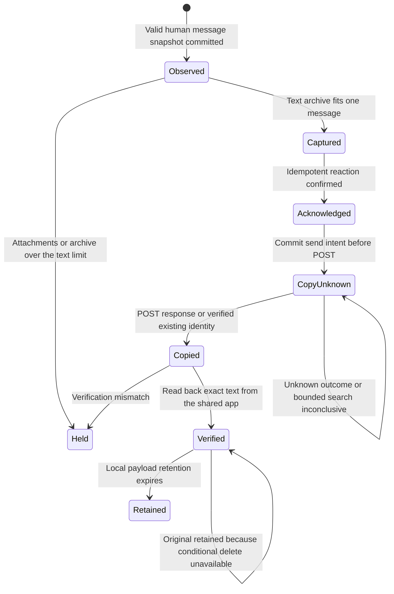

# Automation noticeboard preservation

The preservation unit is a worker, a deterministic service pass, a read-only gateway event reader and a text-only Discord message adapter. The adapter uses an injected Pots call transport. The unit is off by default and has no installed service or startup hook. Nothing here removes a Discord message.

The intended feeds remain writable. The requested outcome is PR entries in the pull-request feed, server events in the server-log feed, and acknowledged discussion below legitimate parents. Automatic removal cannot meet the strict no-loss requirement with the known Discord API. Message deletion has no version precondition that atomically binds it to the archived snapshot. An edit can arrive between a final GET and DELETE. Verified archives therefore retain the original and expose `conditional-delete-unavailable`. Permission changes, a delay or a final read do not close that race.

## State and ownership

`noticeboardServicePass` reads normalized event references, commits them to the local inbox, and runs `noticeboardPass` without a model turn. `noticeboardDiscordInbox` reads only event IDs, kinds and message references from the observed `gw_events` rows for the configured account and guild/channel pairs. Create and edit events cause a current message GET. Delete events are not used as message content. This is a callable service unit, not an installed daemon.

The SQLite store owns the inbox cursor, pending references, revision records and outbox. SQLite transactions publish changes with WAL journaling and FULL synchronization. A per-database `flock` serializes worker side effects across processes. The worker writes the uncertain-send state before requesting a copy.

A source revision key hashes canonical JSON with sorted object fields, including original channel/message identity and timestamps. Temporary attachment URLs are excluded from identity so refreshed bearer URLs do not cause another copy. The saved snapshot still retains the original metadata unchanged. Repeated events for the same snapshot reuse that record. An edited snapshot gets a separate record. The 24-character nonce derives from that key. Discord's recent nonce enforcement is additional protection, not an exactly-once guarantee. An uncertain send never causes another create request, even after the nonce window expires. Bounded reconciliation may prove a matching existing copy. Failure to find one proves no absence and leaves the record uncertain.

Edits during preservation cannot cause data loss through this code because there is no delete operation. A source deleted before it can be read cannot be recovered from an event reference. Existing snapshots remain available after a source deletion. Comments with attachments keep their snapshot, including attachment metadata, and are held without a reaction or copy. Components, embeds, pinned messages, webhook messages and all bot-authored messages are left untouched. Bot identity alone proves neither a legitimate entry nor conversation. No manual provenance registry or author allowlist is introduced.

The text-only adapter identifies automation as the copier and includes the original link and a JSON snapshot in one message. The snapshot records exact content, author identity, display name as returned by Discord, timestamps and reply references. It holds the local snapshot without a reaction or POST if the full copy exceeds the text limit or the original has attachments. It verifies the exact posted message ID, configured thread, shared app author, absence of a webhook, and complete content on GET. It does not search for an unknown POST or retry it.

## Trust boundary

| Trusted principal | Untrusted principal |
| --- | --- |
| Versioned service code and its owner adapter. The existing shared-app gateway owns the Discord credential. This unit neither reads nor receives it. | Gateway event envelopes, Discord message text, author names, attachment metadata and API responses. |

Message text never becomes executable code, shell arguments or model instructions. The only subprocess here is a fixed `flock` invocation with an inherited file descriptor. Normalized inbox records contain only event ID, channel ID, message ID and event kind, plus retry bookkeeping. Raw hooks and transport tokens are excluded. Unsupported snapshot metadata is held rather than silently copied as understood. The adapter derives app ownership of a copy from an authenticated Discord read, never from an event's ownership claim.

The archive intentionally preserves arbitrary user text, which can contain private or secret content. There is no content scan, redaction, or claim that archived user content is free of secrets. Service credentials must never enter records, packets or logs. Results expose fixed status/reason codes rather than message bodies or provider errors. The directory must be owned and mode 0700, and database/lock files must be owned regular files with mode 0600. SQLite WAL files inherit the database permissions. This is same-user file protection, not isolation from other processes under that user, root or backups.

## Limits and retention

`NOTICEBOARD_LIMITS` owns the limits. Configuration is off unless `enabled` is exactly true. At most two explicit feed routes are accepted. Each route supplies its guild, channel, discussion thread, parent message ID and feed kind. A thread started from a message has the same ID as that starter message. The route therefore requires `threadId === parentMessageId`. IDs belong only in private runtime configuration. Each actual parent/thread relationship must be authenticated by the owner adapter. The worker does not create discussion parents in a feed.

The limits bound revision records, pending events, serialized archive/inbox payload, message snapshot size, attachment metadata entries and events per batch. SQLite files, WAL overhead and allocated free pages can exceed the logical payload limit. A full store rejects intake transactionally without advancing the cursor or discarding earlier work.

Each operation allows at most five attempts with exponential delays starting at two seconds. A bounded rate-limit delay up to one hour takes precedence. An invalid or longer delay holds the operation for reconciliation. Copy creation is attempted once per revision, while safe reads, verification and idempotent reactions may retry. Unknown copies remain unknown after their retry budget and require owner reconciliation.

After 30 days, verified local snapshot and archive payloads are logically removed, while the revision key, copy identity and duplicate-suppression metadata remain. This is logical retention, not secure erasure from storage or backups. The Discord archive remains. Unverified and uncertain content is never automatically expired. It occupies the bounded capacity and eventually stops intake rather than losing evidence. Export, resolution or disposal of held content requires a separately defined owner procedure. No purge command is provided.

## Owner integration

`gw_events.raw` contains a Discord message payload directly, not a `{t,d}` gateway envelope. Updates may be partial, so the reader issues a current message GET. Deletes contain only message, channel and guild IDs. `gw_events.id` is local arrival order, not a Discord revision or proof that all earlier mutations arrived. `at` is Unix milliseconds and cannot authorize deletion. The gateway gives no event-retention or gapless delivery guarantee. Cached received files can disappear, and large or unavailable files may have only a URL.

The Pots call transport offers message GET, POST, PATCH and DELETE, starting a thread from a message, a single local-file upload, and refreshing signed attachment URLs. Refresh responses contain bearer URLs and must remain private to the adapter. It has no generic attachment download or permanent copy-reconciliation primitive. Nonce deduplication lasts minutes, so the text adapter relies on the durable send intent rather than a nonce capability in Pots call.

The production adapter provides `read`, `createCopy`, `readCopy` and `findCopy`. It does not provide `permissions` or `react`, and the worker calls both for every event it preserves. Their live Discord behaviour is unverified, so the owner supplies them before wiring the worker. `permissions(route)` returns `canRead`, `canWrite`, `canManageMessages` and `isThreadBound` for the shared app on that route. `react(route, messageId)` adds an idempotent acknowledgement reaction to the original. Without them every event ends as `capture-unavailable` and nothing is preserved.

Pinned messages are protected by their pin. Shared-bot identity, `from_me`, display names, webhook identity and content keywords do not prove semantic publication. Each producer must define its publication signal at its write path before classification or suppression is wired. This unit does not classify producer messages or change an existing writer. Mastermind defines where feed-origin conversations and approvals are routed before any duplicate suppression is enabled.

The runtime-owned `pot-voice` helper's `post` always writes top level. `say` can target an existing thread or create/reuse one on a supplied message. `open` emits a conversational origin notice. The helper has no semantic event field, durable copy key, unknown-outcome reconciler or suppression switch. Its HTTP 429 retry loop does not prove permanent idempotence. Preventing conversational feed duplicates requires a separately reviewed change at its owning writer/control path.

Before production wiring, Mastermind binds the message operations to its shared app account and verifies the real discussion thread, its starter message, channel permissions and reaction path. The text adapter checks the configured shared app user and exact copy identity. Attachment comments stay in the feed until an owner transport provides an authenticated byte download, an exact archive upload through Pots, and a download of that specific copy for byte verification. An unknown send stays held. No absent-result search can authorize a fresh send or destructive retry.

Approval dialogs remain on the protected shared-app path. This code does not move, rewrite, register or enable them. Setup must prevent unsupported dialog placement or leave it safely until resolved.

Activation requires a separately authorized private enable setting, verified Manage Messages and read/write permissions, verified thread relationships, and an approved service installation/restart window. Manage Messages grants no removal authority here. Missing permissions produce read-only Discord behavior. Disabling the switch stops processing and keeps originals, copies and local evidence. Rollback does not attempt to undo external posts or recover deleted source content.

The offline fixtures do not cover live Discord behavior, rate limits, nonce windows, upload/readback, role permissions, event retention or runtime voice behavior. Those need the owner contract and a separately authorized integration check.

## Server-log sources

Server-log notices come from the source watcher and Discord Admin, outside preservation. Both producers are off unless `AGENT_SANDBOX_SERVER_LOG_EVENTS=1` is set in their runtime environment.

The watcher records provisioning failures in the private `~/.config/agent-sandbox/server-log/source-refresh.sqlite` database. Repeated failures reuse the open incident's identity across restarts. The first subsequent successful refresh records the recovery time on that incident. Routine successes are silent. A storage error holds the completed observation in memory and pauses further refreshes until the write succeeds. Committed observations survive a restart. A process loss before commit can lose the observation still in memory.

At capacity, the watcher can retry and record recovery for the open incident. Once it closes, refresh runs pause until the collector acknowledges a closed record and makes room for a new failure. The watcher reports the pause in its local service log. Unread incidents have no expiry. If a prior installation has a `source-refresh.json` warning, collect it before switching to the database. The watcher leaves that file in place.

Admin includes a `serverLogEvent` field on a completed channel topic edit when the prior topic differs and both the PATCH result and a fresh guild-scoped GET confirm the requested topic. A failed or mismatched readback leaves the mutation result intact and omits the event. The typed receipt includes neither the topic nor the audit reason. It is returned with the Admin command result and has no separate delivery queue.

Mastermind owns the mapping from trusted source pot to an approved display label, the server-log channel and the posting identities. Mastermind's publisher uses `renderServerLog` with the watcher's typed `warning` or the Admin response's `serverLogEvent` once those sources are bound. A label's syntax check does not establish its provenance or approve it for publication.

The owner collector opens `sourceRefreshIncidents(path)` locally in the source pot under the database owner's identity. It reads snapshots with `readPending()` and durably saves each snapshot with its bound pot, warning ID and `recoveredAt`. It then calls `acknowledge(snapshot)` against the same database with the original snapshot. A read leaves the snapshot pending. An acknowledgement of an open warning retains its identity and makes its later recovery available under the same ID. A stale acknowledgement leaves the recovered snapshot pending, and a duplicate acknowledgement has no effect. The publisher uses the saved recovery fact to report the incident's current status. `close()` releases the database connection.

Before enabling either producer, Mastermind must verify collection, event ID handling, post and readback with the bound identities. For the covered Admin operation, the owner must use the typed receipt in place of the free-text `Server log:` handoff. The source contract only covers provisioning failures and confirmed channel topic edits. Delivery guarantees and coverage of other services or Admin operations depend on the owning runtime.

## Offline verification

`./bin/check` runs the `session/noticeboard-*.test.mjs` files with the repository's existing Node test runner. The fixtures use invented identifiers and text. They exercise exact attribution, sensitive user text preservation, attachment holds, corrupt copies, duplicate/reordered events, edits, restart recovery, durable cursor semantics, uncertain outcomes, permission denial, unsupported messages, bounded retries and disabled behavior. No external credentials or network access are needed.
