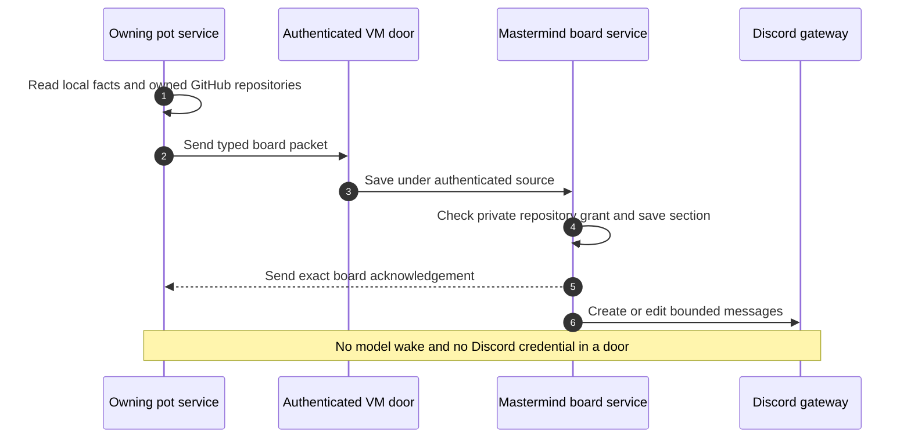

# Pull requests in Discord

Each pot publishes only its own worker and factory facts. Mastermind displays them through the shared Discord app without asking a model to interpret the update. Accor controls whether and what it publishes. Another pot never queries Accor's repositories for this board.

## Trust boundary

| Trusted principal | Untrusted principal |
| --- | --- |
| The VM binds the caller's SSH key to its pot. Mastermind selects the private Discord account and channel. The signed session code validates packets and renders messages. | Every byte in a neighbour's snapshot, including repository names, titles, worker names, states and timestamps. |

Discord credentials stay inside the gateway. GitHub reads use the publishing pot's credential wrapper. The board runs no project code, hooks, installs, shell fragments or checkout-configured commands. Titles are JSON strings, never arguments naming a program, route, file or command. The session user retains its existing access to its own processes and files. This feature adds no process isolation or network grant.

| Channel | Closure |
| --- | --- |
| Environment and process inspection | No Discord credential enters the board process or a door. The gateway alone makes authenticated Discord requests. |
| Sourced files, tool configuration and lookup paths | The service runs signed session code, invokes the installed credential wrappers, and never enters a project checkout or loads its configuration. |
| Privilege | The service runs as the session user and invokes no privileged command. |
| Shared files | Private atomic records and file locks hold snapshots, delivery IDs and Discord progress. Remote text never supplies a path. |
| Shell evaluation | Door bodies and Discord bodies are parsed JSON. No remote value is evaluated as shell text. |
| Output | Failures log fixed messages. Rendered text strips Markdown, mentions, control characters and URLs. Only a derived GitHub pull request URL becomes a link. |
| Network | Existing doors carry only validated display packets. Discord routes use private configuration and saved message IDs. GitHub routes use validated repositories owned by the publishing pot. Existing session network permissions remain the perimeter. |

The board tests exercise injection, forged ownership, wrong direction, malformed packets, replay, pagination, disabled switches, expired sections and durable delivery. No fixture requires a live Discord or GitHub call.

## Configuration and operation

The private `pullRequestBoard` object in `/etc/agent-sandbox/sandbox.json` is absent by default. Set `enabled` to `true` only after rollout approval. When disabled, the board does not read source records, contact GitHub, send packets, read received board records or call Discord.

Mastermind also needs `channelAccount`, the shared app's Discord account name, `channelId`, the target channel, `guildId`, its server, and `sources`, a map from authenticated pot names to exact permitted GitHub repository names. Include a `mastermind` entry to publish its local section. A pot cannot claim a repository outside its private grant. These identifiers stay private. The app needs permission to view the channel, send and edit its own messages, and `PIN_MESSAGES` permission to pin the index. The private Factory webhook helper is not used. Existing webhook-owned snapshots cannot be edited by the shared app. Mastermind must retire the old hand-made pin after verifying the new board.

`node session/pr-board.mjs --run` performs one pass. With no flag it runs the session service. Configuration is read when the process starts. Use the same service for collection, delivery and rendering. Its lock prevents simultaneous one-shot and service passes.

## Transport and ownership

Board packets use a separate `board ORIGIN.NONCE` wire header, admitted under the same authenticated ask access as ordinary requests. They never enter human-dialog helpers, handlers, receipts or storage. The publishing collector may read its own open human dialogs as state evidence. Ordinary requests containing the same JSON remain ordinary requests. Board packets never wake a bot and cannot carry instructions or human answers. Mastermind accepts a section only under the authenticated caller's name, with no pot field supplied by the packet. It accepts only privately allowed sources. Non-Mastermind receivers refuse snapshots. Replies are exact `{"type":"pr-board.ack","version":1}` acknowledgements. The generic receiver returns from its wake function for `kind: "board"` on both requests and replies. The `pots-pr-board` process reads these requests, commits the packet to its own store, and sends the acknowledgement. It never calls `pots wake`.

A section packet has `type: "pr-board.section"`, `version: 1`, `snapshot`, `publishedAt`, `part`, `parts` and `pulls`. Each pull has `repository`, `number`, `title`, `workers`, `githubState`, `state` and `createdAt`. Recorded exceptional states also have `evidence`. Merged pulls have `mergedAt`. Snapshot parts carry a digest of the entire ordered pull list. The receiver installs a snapshot only after every part arrives and the digest matches. An older timestamp cannot replace a newer section. Limits and validation live in the board contract. A source exceeding them fails publication instead of publishing an incomplete list.

`pr-board.events` carries `version: 1` and bounded `events`. Each event has an ID, repository, number, kind and time. Factory verdict events also have a verdict. Persistent event IDs prevent normal resend duplicates. A local journal captures every verdict and merge before the factory's record advances. While enabled, factory result reporting saves its outcome without waking the work center. A board outage leaves the journal to retry. The disabled path preserves existing factory reporting.

## Display and failure behavior

Merged today means the UTC calendar day. State comes from GitHub unless a matching open human dialog, explicit stopped-worker marker or current-head factory stop records an exception. A factory review is shown only for a recorded active review. Worker titles come from local worker records, never from another pot's terminal. A missing worker is shown as unassigned.

Mastermind treats state as the owner's report of a GitHub read. It labels GitHub state separately from local evidence. Events say which pot reports the merge or verdict. They are neither independently verified verdicts nor permission to merge.

Mastermind edits one pinned index in place. If the board fits, that message holds all rows. Otherwise it links continuation messages, each within Discord's content limit. Shrinking the board clears obsolete continuations. Updates are coalesced and unchanged content is not sent again. Collection and door pacing are defined in the board contract. The existing VM delivery bucket is shared with other door traffic, so congestion delays large snapshots and their sections can become stale. No partial snapshot is advertised as complete. Discord failures leave saved progress for a later pass. Stale sources show their last publication time and no former rows as current. Unknown sources show that no snapshot has arrived.

The service saves a stable nonce before creating a Discord message and uses Discord's enforced nonce deduplication on retries. A crash after Discord accepts a create but before its response is saved can still duplicate a message after Discord's nonce retention expires. Do not claim exactly-once delivery across an arbitrarily long outage. Edits and pinning retry against saved IDs.

## Rollout

Keep the PR in draft until the parent lifts the design-review hold. No rollout is performed by development checks.

1. Review and merge the feature, then publish it through the existing signed-tip process. Leave all board switches disabled.
2. Update the signed session source on Mastermind and each participating pot. Run `bin/vm-up` for every pot that receives the new header, including Mastermind, to refresh the installed `/usr/local/sbin/pots-door` gate. A signed tip alone cannot activate this wire kind. `vm-up` also applies configuration. Its VM setup restarts `pots-door.service` and `pots-vault.service`, and restarts `tailscaled.service` only if its pinned installation changes. It starts the firewall and timers without restarting the firewall.
3. Restart each participating session with `bin/pots-session restart` so image initialization registers the new `pots-pr-board` custom service. This stops and starts every session process and interrupts existing workers, so schedule it with the parent. Persistent home and Docker volumes remain. Then run `bin/session-bootstrap`. It restarts `pots-router`, `pots-tailnet`, `pots-gateway`, `pots-watcher`, `pots-sources`, `pots-human-relay`, `pots-discord-human` and `pots-pr-board` after provisioning. The new service remains idle while disabled.
4. Configure Mastermind's private account, channel and source allowlist, enable its switch, and start or restart `pots-pr-board` there. Verify the app's first message, pin permission and suppressed previews before enabling publishers.
5. Each owning pot approves its section's content, enables its own switch, and starts or restarts only `pots-pr-board`. Private config synchronization uses the normal `bin/vm-config` path. Every board process needs a restart after a configuration change. No existing door, human-dialog or worker service needs a feature-specific restart.
6. Verify authenticated publication, a merge, a verdict, retry after a gateway restart, overflow, staleness and UTC rollover in the actual channel. Retire the old pin and stopgap model reporting instructions only after those checks pass.

Real Discord permissions, nonce behavior, rate limits, message links and gateway restart recovery remain live rollout checks.
