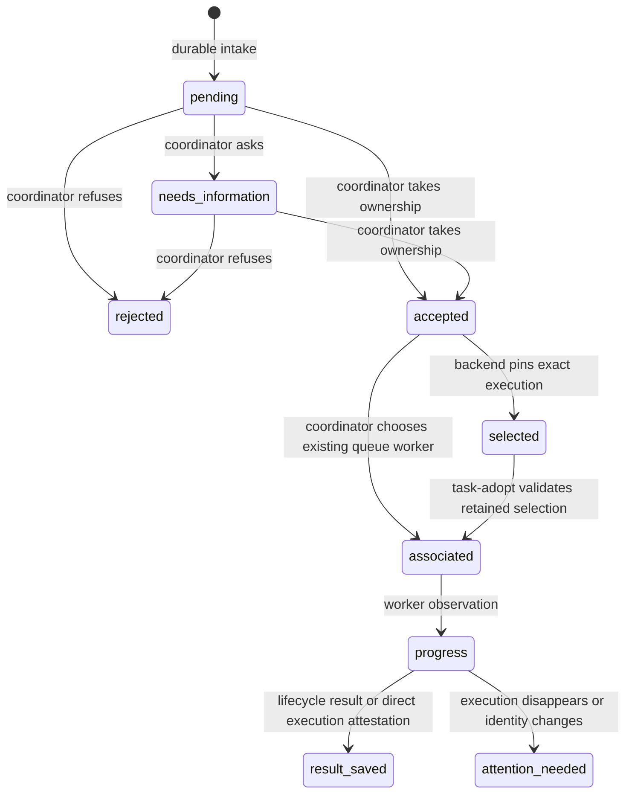

# Pot task handover

This is the sandbox contract for a Herdr submission to its owning pot. Installing the reviewed, signed source through the normal rollout activates it. A source push alone does not install it. Herdr presentation belongs to `agent-herdr`.

## Control contract v2

`session/task-contract.mjs` owns the protocol version. Read `snapshot.taskContract` before enabling controls. It returns `version`, the configured local `target`, and `operations` derived from the actual control registry. Require version 2 and every operation the UI uses, including `task-select` before adoption. Each `task-*` request must carry `"version":2`, and each task-row reply carries `version`. Missing or incompatible versions fail before the operation runs. Version 1 clients are refused because an address-only adoption retry could select a later conversation before its first backend commit. Snapshot itself takes no version argument.

Invoke `node /opt/agent-sandbox/session/control.mjs OPERATION -` with one JSON object on stdin. A JSON argument also works when the caller passes a real argument array. Never interpolate task JSON into a shell command. The target is the configured lowercase bot ID returned as `owner` in task rows. This contract has no machine parameter and never routes into another pot.

| Operation | Input beside required `version` | Result |
| --- | --- | --- |
| `task-submit` | `id`, `target`, `text`, `provenance` | Durable intake and an attempted bot wake, followed by the current task row |
| `task-decide` | `id`, `state`, `reason` | Coordinator decision, with `state` equal to `accepted`, `rejected` or `needs-information` |
| `task-associate` | `id`, `worker` | Associate an accepted task without a pinned selection with an existing registered worker owned by this bot |
| `task-select` | `id`, `terminal` | Persist the backend-observed exact execution fingerprint before any adoption attempt and return the task row with `selection` |
| `task-adopt` | `id`, `selection` | Validate the retained backend-issued selection against current execution identity, then associate it without launching or reparenting |
| `task-result` | `id`, `sessionDigest`, `summary` | Preserve a direct execution's final transcript and screen with an explicit coordinator attestation |
| `task-delivery` | `id`, `delivery`, `state`, `reason` | Resolve an uncertain adopted follow-up after inspection, with `received` removing it or `retry` permitting another send |
| `snapshot` | No argument | Existing snapshot plus `taskContract` and `tasks`, an array of versioned task rows |

`id` is 1-96 letters, digits, dots or hyphens, beginning with a letter or digit. Herdr creates it once and retains the complete original payload for retries. Text is nonempty, contains no NUL, and takes at most 16,384 UTF-8 bytes. `provenance` has exactly `source`, `author`, and `reference`, each subject to that text limit. Submission refuses unknown fields. A different payload under an existing ID fails without replacing the intake. Decision reasons and coordinator result summaries use the same text validation.

Control writes one JSON task row to stdout on success. A nonzero exit writes a diagnostic to stderr. After any lost reply or failed observation, inspect the snapshot and reuse the original payload and ID. Do not treat an error string as a persisted task state or create a new task automatically.

The intake wake has `kind: "task-intake"`, the same `version`, `id`, `target`, `text`, and `provenance`, plus a fixed instruction about trust and explicit decisions. Its durable receipt ID is `task-intake-ID`. `delivery.state` is `unknown` before the transport call and remains so on any failed reply. Success records `delivered`. Neither state means acceptance. Repeating the original submission retries an unknown wake under its original receipt ID. Pots deduplicates that wake identity. After an uncertain Herdr transport reply, reconnect and inspect `snapshot.tasks`, then repeat the original submission if needed.

`acceptance` contains `state` and, after a decision, `reason`, `by`, and `at`. Acceptance is an explicit coordinator action. Accepted and rejected decisions are final. A repeated identical decision preserves its original timestamp. `needs-information` can later become accepted or rejected. Additional discussion uses the existing bot conversation, rather than editing an intake's immutable content.

## One relationship and one execution store

`session/tasks.mjs` owns intake validation and decisions. Intake records live beneath the existing bot terminal directory at `terminal/tasks/ID.json`. `session/task-store.mjs` serializes changes under a process-safe file lock. These records contain no worker status, execution or outcome copies. `session/task-selection.mjs` owns selection validation. The existing intake record retains only `selection.terminal` and `selection.identity`, a SHA-256 fingerprint bound to this protocol, pot, task ID and exact backend-observed execution metadata. It stores no second worker record.

`session/workers.mjs` owns the relationship. `WORKER.task` is the only persisted task association, projected as `worker.taskId`. It is separate from the mutable worker JSON because watcher saves can carry an older copy. Worker saves use their own file lock and cannot overwrite another association. Task operations hold the intake lock before changing the worker relationship. No worker save acquires the intake lock. Existing worker records, queue files, lifecycle files and result storage retain their responsibilities.

For a new worker, the coordinator uses the existing dispatcher with `--task ID` in addition to its existing arguments. It requires prior acceptance and no pinned adoption selection. A selected task must use `task-adopt`, and neither `dispatch start --task` nor `task-associate` can bypass that pin. Repeating that start with the same repository, branch and brief returns the existing associated worker, even after restart. Changing those selections under that ID fails. The normal queue, capacity checks, launch identity, exact Pi session and result acknowledgment remain in use. Task intake never starts a worker. Repository publication and approval rules still apply to dispatch. A partial Git/worktree/PR failure remains an actionable dispatch failure, rather than permission to create a replacement.



Delivery is independent of these states. `associated`, `progress`, `result_saved` and `attention_needed` in the diagram describe derived execution facts, not a second persisted task state machine.

## Snapshot and shared reporting facts

Each task row exposes `version`, `id`, `target`, `owner`, `text`, `provenance`, `receivedAt`, `receipt`, `delivery`, and `acceptance`. `selection` is absent until `task-select` persists its immutable `terminal` and `identity`. This pin authorizes no launch or approval. `execution` is absent until association. It then exposes:

- `worker`, the registered worker identity, and its recorded `terminal`, `sessionFile`, and `sessionId` when available.
- `mode`, either `managed` or `adopted`, and the preserved native `parent` for adoption.
- `observedStatus` is the raw live terminal status. `status` also accounts for broker waits, runtime waits and follow-up delivery. An idle or done terminal with pending deliveries is `waiting`. An absent execution without a saved outcome can require `attention-needed`. A launch failure also exposes its saved `failure` reason.
- `wait.kind: "human"` identifies an open broker dialog bound to this worker and its current session. Its `owner`, `dialog`, `startedAt`, `action` and optional `delivery` come from the broker record. Delivery and posted context carry no approval capability. The broker remains the only path for the human action notice and receipt. A runtime wait uses `wait.kind: "internal"` and the current launch's `waitingSince` when published by the runtime. The work owner handles internal waits and failures.
- `deliveries` lists pending queue IDs and recent receipts before queue cleanup. `queued` means waiting to send. `sent` includes `sentTo`, the launch ID recorded by the dispatcher. `received` requires that request ID in the verified lifecycle record for the current launch. `unknown` is an adopted follow-up with an uncertain send. A transport success, unchanged turn count, or settled-looking terminal does not establish receipt. The queue removes a managed request after Pi records its receipt.
- Worker `branch`, `commit`, `uncommitted`, `unpushed`, `cleanPass`, `pullRequest` and `result` facts when available.

`snapshot.standaloneExecutions` lists local Pi sessions that hc still exposes without a registered worker. Each record preserves the observed terminal, native parent, canonical session file and session ID. An ended terminal may still report raw `done` while its observation status is `ended`. It has no task association, result claim or authority to launch or resume. If hc no longer exposes a terminal, Herdr retains its own history. The sandbox does not reconstruct it from a parent label or write a new history store.

A result is the existing worker result object with `id`, `state`, `screen`, and `transcript`. A direct execution's result additionally exposes `kind: "coordinator-attestation"`, `sessionDigest`, and `summary`. It records what the coordinator explicitly attested. It does not assert the presence of runtime pending-work checks in that direct process.

`session/task-view.mjs` is the sole projection for both snapshot and bot reporting. The existing watcher sends changes as a normal Pots wake with `kind: "task-report"` and `task` equal to the same task row. A deterministic digest supplies the wake ID. A missing transport reply leaves it retryable on the next observation or watcher restart. Task workers use this shared reporting wake in place of the ordinary worker-status wake, including launch failures and saved outcomes. The coordinator relays those facts through its existing conversation/Discord reporting route with the task ID. No separate Discord status computation or Discord credential is introduced.

Herdr must retain the task ID across reconnects, display delivery separately from acceptance, and render execution status and result from this row. Sending text or seeing a terminal alone does not assign a task. Submission and adoption are explicit actions. If the local control contract is absent or incompatible, show that the installed sandbox needs its normal rollout. Never fall back to direct execution. Use Herdr's current navigation and terminal-opening flow. This contract depends on no Pots view, Command Center or runtime-configuration screen.

## New task example

Herdr submits this synthetic payload to the selected pot through control stdin:

```json
{"version":2,"id":"task-synthetic-001","target":"synthetic","text":"Produce the synthetic report.","provenance":{"source":"herdr","author":"synthetic-person","reference":"synthetic-thread"}}
```

A synthetic successful reply before a coordinator decision has this shape. Timestamps here are illustrative:

```json
{"version":2,"id":"task-synthetic-001","target":"synthetic","owner":"synthetic","text":"Produce the synthetic report.","provenance":{"source":"herdr","author":"synthetic-person","reference":"synthetic-thread"},"receivedAt":1700000000000,"receipt":"task-intake-task-synthetic-001","delivery":{"state":"delivered","attemptedAt":1700000000001},"acceptance":{"state":"pending"}}
```

An uncertain wake reply keeps `delivery.state` as `unknown` with its attempt timestamp. Acceptance remains independently `pending`, and `execution` is absent. After acceptance, the reply and snapshot carry the same row with `acceptance.state`, `reason`, `by` and `at`. Association adds the execution fields defined above without changing the submission identity or provenance.

The coordinator decides, then selects its worker through the existing dispatcher:

```sh
node /opt/agent-sandbox/session/control.mjs task-decide '{"version":2,"id":"task-synthetic-001","state":"accepted","reason":"This pot owns the report."}'
node /opt/agent-sandbox/session/dispatch.mjs start --task task-synthetic-001 --title 'feat: synthetic report' --subject 'feat: synthetic report' example/project feat/synthetic /config/synthetic-brief.md main
```

These are examples for an installed sandbox under its normal publication rules. They are not rollout instructions or approval to push.

## Existing execution example and limits

After accepting `task-synthetic-002`, first pin its exact execution through the backend:

```sh
node /opt/agent-sandbox/session/control.mjs task-select '{"version":2,"id":"task-synthetic-002","terminal":"t7"}'
```

Retain the returned `selection.identity` and the complete adoption envelope before the first adoption attempt. Send this shape through control stdin, replacing the placeholder with that exact returned value:

```json
{"version":2,"id":"task-synthetic-002","selection":"<reply.selection.identity>"}
```

Call `task-adopt` with that retained envelope on every retry. The backend looks up the pinned terminal itself and re-derives its identity before any association, including retries after a prior association. The request accepts no caller-provided terminal, cwd, session or parent metadata. The selection is a public fingerprint, not a credential or approval receipt.

A request lost before the first adoption commit still retains the already-persisted fingerprint. Changing the session path, session header ID, creation time, argv, cwd, name or parent makes adoption fail without changing the selection or associating a worker. Repeating `task-select` cannot replace the pin with the current conversation. Only an explicit new task identity can choose different work. Normal transcript appends with the same session identity remain valid. A lost reply after adoption retries the same fingerprint and returns the same worker.

If the selection reply is lost, inspect `snapshot.tasks[].selection` and retain the saved value. Until a backend selection has been acknowledged and retained, no adoption attempt is allowed. Herdr must never recapture selection during adoption retry or fall back to the old address-only request. Local terminal addresses remain scoped to the selected pot's existing connection. After association, the reply and snapshot expose the recorded address, exact canonical `sessionFile`, `sessionId`, unchanged native `parent`, and derived status in `execution`.

Adoption uses installed hc's `created_ms`, `argv`, local address, name, cwd, parent and `pi.session` label. The address must resolve to exactly one live terminal. The cwd must resolve beneath this pot's `Development` directory. The session must be a regular `.jsonl` file, no larger than 16 MiB, under this pot's Pi or worker session directory, with a Pi session header and exact ID. Symlinks resolving outside these directories are refused. Local aliases retain their published metadata and canonical destinations, and retargeting one invalidates the execution match. Another worker or managed owner on that execution is refused. Associate an existing registered worker with `task-associate` instead.

The original parent, argv, Git state, worktree and conversation are preserved. The owning bot tracks it through a registered worker association. A changed identity or vanished terminal needs inspection and cannot produce completion or an automatic replacement. `dispatch send` reaches a proven live adopted terminal. An uncertain send remains queued as `unknown` and is not automatically repeated. The coordinator inspects the exact conversation before resolving that delivery with `task-delivery`. `control stop-worker` can explicitly stop the proven execution.

A direct execution has no hot-installed worker lifecycle extension. After reading its final report, the coordinator can call `task-result` with the SHA-256 of its exact conversation and a summary. The terminal must be idle or done, the conversation must have a final assistant reply and no open goal, and the worktree must be clean and published. The existing result storage preserves its screen and exact transcript. The first outcome is final and retryable. `dispatch finish WORKER RESULT_ID` acknowledges this saved result while leaving the native terminal open.

Reparenting a native Mac child and resuming a vanished direct execution inside that same terminal are unsupported by hc 0.1.21. This contract refuses an automatic relaunch. Restoring an ended native execution requires a separately chosen supported operator action. Managed workers retain their existing exact-session resume behavior.

## Trust and activation

| Trusted principal | Untrusted input |
| --- | --- |
| Installed pot-local control and owning coordinator under existing pot rules | Herdr text, claimed provenance, display content and submitted identifiers |

The task code neither requests credentials nor changes credential scope. JSON remains parsed data and fixed argument values. It is never shell source, a launch command, a human-dialog result or an approval receipt. Claimed author metadata is preserved for display and audit, without authenticating a human or granting push, spend, credential or relaunch approval. Any same-user process that can invoke existing local control can also invoke coordinator operations. This is an intake contract, not isolation from a hostile session user. It accepts parsed task fields and adds no new environment, filesystem, process, privilege, tool-configuration or network isolation around existing workers. Existing launch and publication rules remain the boundary for running repository code.

Activation requires parent design approval, release of the rollout freeze, the normal reviewed and signed sandbox rollout, a watcher running that installed source, hc metadata compatible with the declared identity checks, and paired Herdr controls using this contract. No unmerged API from sandbox PR #43 is required. Herdr source needs this contract available before enabling submission/adoption controls. This PR remains draft until its hold is explicitly lifted.

Read [source validation evidence](task-handover-validation.md) for the pinned before/after commits, test requirements, measured fixture timings and release blockers.

Run `./bin/check` for the repository checks and `node --experimental-test-module-mocks --test probes/task-*.mjs` for the representative flow. The flow executes real control, dispatch, queue, worker runtime/inspection and result code in fresh child processes. Herdr transport, coordinator choices, external hc/Git/GitHub/Pots commands and the Discord bot/API are synthetic fixtures. It proves local state and boundary behavior, not live Discord clicks, model judgment, Mac rendering, real worker execution or native parent control. Test diagnostics separate disposable setup, execution and cleanup time. They are measurements of these fixtures, not production performance estimates.
