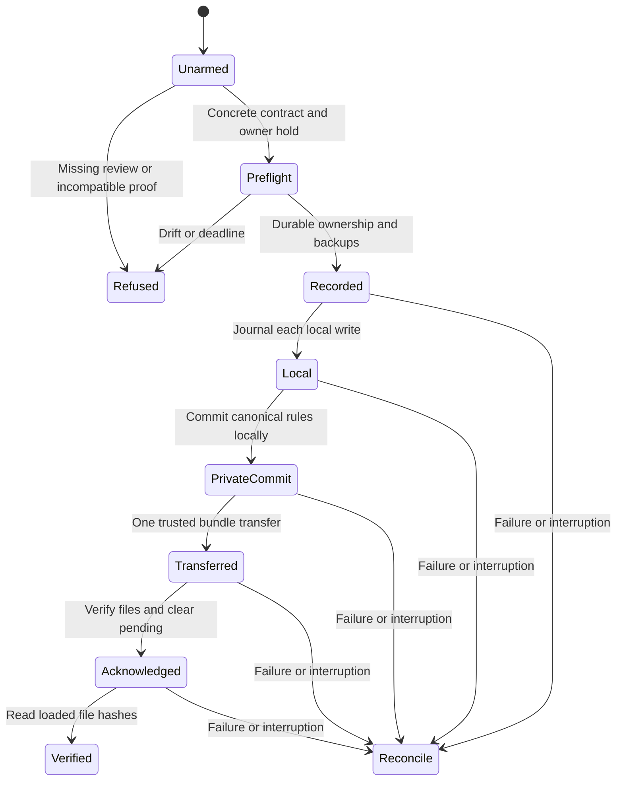

# Reviewed rules-only import

This runner imports an exact private recipe and transfers its approved rules through the existing trusted configuration route. It prepares a private canonical commit locally and requires separate publication approval.



Start with the read-only resource manifest:

```sh
python3 -I rollouts/rules-only/run.py manifest
```

The manifest hashes the runnable resources. [The pinned source and approved byte identities](resources.json) define compatibility. The runner must be stored separately from the clean operator checkout it checks. It refuses incompatible Mac or VM implementations without updating either checkout.

A future operator first reviews a concrete [contract and owner hold](review-contract.md). The distribution supplies neither an execution window nor an owner approval. An operator-provided document is an attestation through that owner's established route. Possession of a file or an artifact hash does not establish human approval.

After that separate review, the invocation has this form. Every uppercase word is a required reviewed value, not a default:

```sh
python3 -I rollouts/rules-only/run.py execute \
  --contract /ABSOLUTE/OWNER_PRIVATE/contract.json \
  --contract-sha256 REVIEWED_CONTRACT_SHA256 \
  --owner-proof /ABSOLUTE/OWNER_PRIVATE/hold.json
```

The runner checks the original, recipe and computed result with the pinned `apply_recipe` before durable preparation and immediately before canonical creation. It holds the importer's sandbox directory lock while writing. Hash and state checks repeat between stages. Each read-only command and the aggregate preflight are bounded. Once a mutation starts, expiry does not interrupt it. SIGTERM and SIGINT defer until that stage's postconditions and journal outcome complete, then stop before another stage. There is no execution duration promise.

The unrelated configuration comparison covers the exact bytes the pinned store implementation will write and all optional-file membership. Different JSON formatting on the VM causes refusal even when its parsed values match. After transfer, the runner compares the VM and session files again before acknowledging. A hash proves the file visible to the process, not that an existing agent reread its instructions.

The runner uses the pinned bundle builder and trusted `vm/store-config` route directly. It journals acknowledgement separately instead of invoking the unjournaled `bin/client-rules` or `bin/vm-config` wrapper. It never retries a failed transfer or invokes the old wrapper's recovery advice.

## Failure and reconciliation

The ownership record is created outside the journal directory before that directory exists. The journal records an intent before an operation and confirms it only after its postconditions. File contents and directory entries are flushed to disk. If a failure follows a write, the retained state is deliberately left in place.

The journal owner holds a kernel file lease. Each mutation subprocess gets its own private ledger under the journal's `mutations` directory. The supervisor's process identity is durable before its request is released. The child waits behind another launch gate until its identity is durable. The records bind process start identity, group, session and the scope's unique lease inode. The supervisor waits for the local process group and inherited lease holders before recording its outcome. The [public interruption tests](tests/test_mutation_ownership.py) exercise both gates through a paused synthetic transfer.

SIGKILL, host loss and power loss cannot be caught. A surviving supervisor can finish recording its local outcome, but cannot confirm the dead owner's journal intent. If supervision is lost, an inherited lease or recorded live process reports `LIVE`. An absent completion record remains `UNKNOWN` after the lease releases. Local group completion does not prove that a remote command or an escaped descendant stopped. An arbitrary tool can close inherited descriptors, and unrelated writers remain governed by the owner hold. Native platform behavior requires its own verification before live use.

| Observation | Meaning and next action |
| --- | --- |
| No ownership record and no journal | Preflight did not consume an attempt. Resolve the refusal through the owner before considering a reviewed invocation. |
| Ownership record without a complete journal | Initialization may have been interrupted. Inspect through the original contract and retain the record. |
| `LIVE` owner, lease or recorded process | Wait through the owner route. Inspection withholds target reads while work may continue. |
| `UNKNOWN` continuation, intent without confirmation or `failed-unknown` | Retain the process ledger and reconcile privately with the owner. A released lease or nonzero exit proves no successful recovery. |
| Transfer confirmed but acknowledgement absent | The VM may already hold the result while the local approval remains pending. Inspect both sides through the same owner route. |
| Final file proofs confirmed | The private commit is still local. Publication and any claim about active agent behavior need their own evidence and approval. |

Use the original contract and its reviewed hash for read-only reconciliation. Its window may have expired:

```sh
python3 -I rollouts/rules-only/run.py inspect \
  --contract /ABSOLUTE/OWNER_PRIVATE/contract.json \
  --contract-sha256 REVIEWED_CONTRACT_SHA256
```

Inspection checks ownership and mutation continuation before reading target files or Git state. A live owner, active lease, missing mutation outcome or unconfirmed subprocess stage withholds all target reads and returns `LIVE` or `UNKNOWN`. Inspection never promotes an intent or consumes a retained attempt.

Add `--vm` on the reviewed operator Mac to collect fresh trusted VM and session file proofs only when continuation does not block inspection. The command performs no transfer, acknowledgement, Git update or cleanup. A changed source implementation causes VM inspection to refuse. Inspect the retained local evidence through the owner rather than installing replacement source.

Keep the original contract, ownership record, journal and private backups until the owner reconciles every intent. Do not delete the attempt to bypass the rerun refusal. There is no resume, automatic restore, retry, rollback or restart command. A torn journal requires private owner inspection of the retained bytes. Recovery may require a separately reviewed manual action with a new scope.

## Private information and boundaries

Only fixed diagnostics, hashes, booleans, process status and operation identifiers, and the exact private commit/remote/branch are emitted. Recipe text, rule text, raw configuration bundles and subprocess diagnostics stay out of reports. Backups contain private bytes and remain in the owner's private journal directory.

The [trust boundary](trust-boundary.md) names the cooperating processes and the checks that constrain untrusted source files. Synthetic fixtures use the public command in an explicitly isolated temporary directory. Their hash substitution, delays and injected failures are available only through the fixture subcommand. Production execution exposes no fixture override.

## Tests

The suite needs no credential and writes its fixtures in the OS temporary directory. Run it from the repository root:

```sh
python3 -I -B -m unittest discover -s rollouts/rules-only/tests -t rollouts/rules-only/tests
```

[`./bin/check`](../../bin/check) compiles every runner file and runs this suite.
